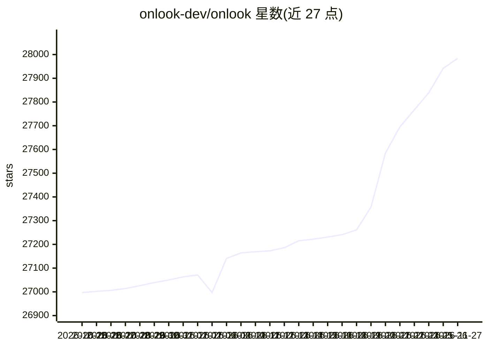

# onlook-dev/onlook

⭐ 27,984 · TypeScript · Apache-2.0 · 推送 2026-11-26 · [GitHub](https://github.com/onlook-dev/onlook) · [官网](https://onlook.com) · 组织维护

**面向设计师的可视化代码画布：连自己的 agent 直接改真实仓库**

本地优先的桌面端可视化编辑器：打开任意 Git 仓库并运行用户的 dev server，在无限画布上以帧形式实时呈现运行中的应用，支持视觉化布局编辑、移动/平板/桌面多帧并排、worktree 安全副本与并行项目标签页。编辑请求交给用户已连接的 Claude Code 或 ChatGPT/Codex 账户执行，由该 agent 修改仓库中的真实文件，Git 记录全部变更；支持一键 PR、HTML/PNG/JPEG/PDF 导出。源码构建无需账户或云端密钥。

## 筛选速览

| 维度 | 判定 | 备注 |
|---|---|---|
| AI 角色 | `ai-enhanced` | 去掉 AI 部分产品仍成立 |
| 许可风险 | `permissive` | Apache-2.0 |
| 部署形态 | `None` |  |
| 模型依赖 | locked-api |  |
| 硬件要求 | — | 无带数字的原话,不猜 |
| 安装摩擦 | `low` | 无编译、无系统依赖或容器化 |
| 成熟度 | — | 结构信号不足 |

## 动量与使用信号

- 维护:`active` — 距上次 push 54.3 天,年发版 0,103 位贡献者
- 涨星:近 1 天 **+13**(自 20261016 起算)

## 能力要点

- 打开本地 Git 仓库并运行用户自己的 dev server，设计即真实产品代码
- 自带 agent 机制：连接已有 Claude Code 或 ChatGPT/Codex 账户执行编辑
- 可视化无限画布与多设备帧并排，worktree 副本保护原文件夹
- 导出自包含 HTML/PNG/JPEG/PDF 工件，支持一键 PR 到合并

## 适用场景

- 设计师在真实代码库上做视觉化界面设计
- 通过对话让 agent 修改页面元素并实时预览
- 快速产出 HTML/PNG 原型分享给同事评审

## 场景标签

`编码 Agent` · 领域:编码与开发

## 证据(README 行号)

> L37: - 🎨 **Built for design.** Onlook is the open-source developer tool for designers. You see your real app running liv
> L38: - 🤖 **Bring your own agent.** We don't ship our own model. Connect the Claude Code or ChatGPT/Codex account you alr
> L40: - 🖥️ **A desktop app, local-first.** Onlook runs on your computer. Your code stays on your computer, and the source

## 星数曲线

2026-10-25 26,997 → 2026-11-27 27,984（+987）

---
*卡片 v1 · prompt 1.4 · 生成 2026-11-26 · 置信度 high · 依据 README sha `a536aa46910b` · [字段定义](../../DATASET.md)*
