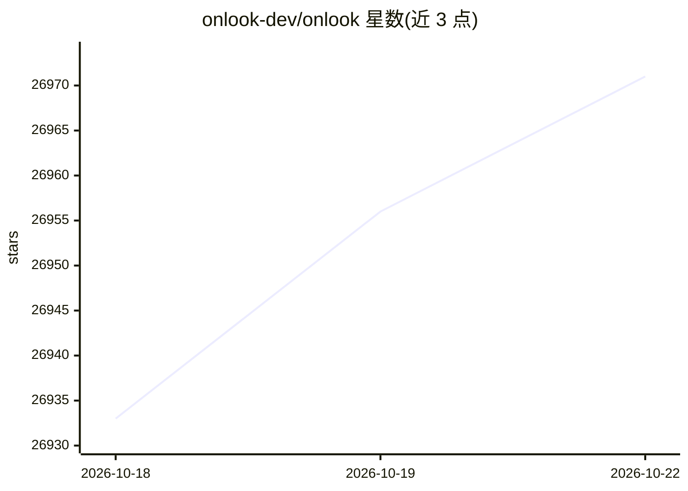

# onlook-dev/onlook

⭐ 26,976 · TypeScript · Apache-2.0 · 推送 2026-10-21 · [GitHub](https://github.com/onlook-dev/onlook) · [官网](https://onlook.com) · 组织维护 · 中文 README

**给设计/前端工程师的开源可视化 AI 代码编辑器**

面向 Next.js + TailwindCSS 项目的开源可视化编辑器：在浏览器 iFrame 中直接编辑 DOM 元素并映射回代码位置，支持从文本或图像起步创建应用、实时预览、图层浏览、分支试验设计、检查点保存恢复，以及带代码访问能力的 AI 聊天。架构上把代码加载进 web 容器运行，通过插桩把元素映射到代码位置，编辑同步回代码。README 明确当前聚焦 Next.js + Tailwind，非该栈的项目尚在待办中；托管托管版处于 early access。

## 筛选速览

| 维度 | 判定 | 备注 |
|---|---|---|
| AI 角色 | `ai-native` | 本体是模型或模型工具 |
| 许可风险 | `permissive` | Apache-2.0 |
| 部署形态 | `None` |  |
| 模型依赖 | — | README 未给出锁定关系 |
| 硬件要求 | — | 无带数字的原话,不猜 |
| 安装摩擦 | `low` | 无编译、无系统依赖或容器化 |
| 成熟度 | `idea` | |

## 动量与使用信号

- 维护:`active` — 距上次 push 54.3 天,年发版 0,103 位贡献者
- 涨星:近 1 天 **+13**(自 20261016 起算)

## 能力要点

- 可视化编辑 iFrame 元素并同步写回代码（插桩映射元素到代码位置）
- AI 聊天具备代码读取与编辑工具
- 分支机制用于试验设计变体，支持检查点保存与恢复
- 架构声明可扩展到任何声明式 DOM 语言，目前聚焦 Next.js + TailwindCSS

## 适用场景

- 在真实代码库上做可视化设计与样式调整
- 从文本或图像快速生成 Next.js 原型
- 在浏览器中拖拽调整布局并实时查看代码

## 场景标签

`编码 Agent` `代码生成` · 领域:编码与开发

## 证据(README 行号)

> L35: # An Open-Source, Visual-First Code Editor
> L37: Craft websites, prototypes, and designs with AI in Next.js + TailwindCSS. Make
> L152: - OpenRouter - LLM model provider

## 星数曲线

2026-10-18 26,933 → 2026-10-22 26,971（+38）

---
*卡片 v1 · prompt 1.4 · 生成 2026-10-18 · 置信度 high · 依据 README sha `225022667bf2` · [字段定义](../../DATASET.md)*
