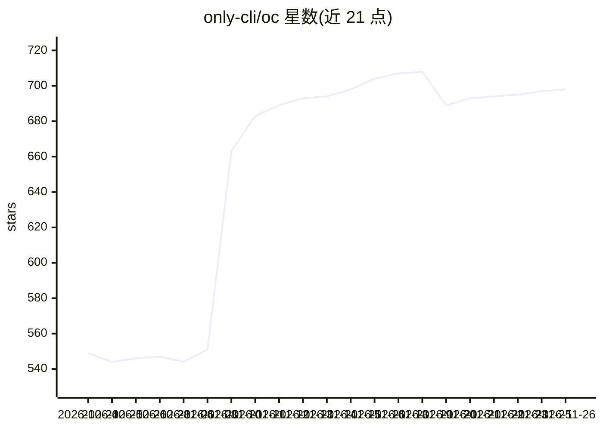

# only-cli/oc

⭐ 698 · JavaScript · MIT · 推送 2026-11-24 · [GitHub](https://github.com/only-cli/oc) · [官网](https://only-cli.com) · 组织维护

**把任意网站压缩为供 AI agent 使用的紧凑 CLI**

一个 Node.js CLI 工具：`oc open <url>` 抓取网页并输出编号化紧凑视图而非原始 HTML，默认 token 预算 500，供 Claude Code、Codex 等编码 agent 浏览网页时节省 token。请求通过模拟浏览器身份（Chrome→Firefox→原生 fetch 降级链）绕过部分站点对简单抓取器的拦截。支持任意静态站点与 JSON API，另附带 40 余个站点的快捷命令（HN、Reddit、GitHub、各语言文档等）。提供 npm 全局安装、npx 免安装、agent skill 与 Claude Code 插件四种接入方式，需 Node 20+。与 OpenShift 的同名 `oc` 存在 PATH 冲突。

## 筛选速览

| 维度 | 判定 | 备注 |
|---|---|---|
| AI 角色 | `ai-ecosystem` | LLM/agent 周边工具 |
| 许可风险 | `permissive` | MIT |
| 部署形态 | `library` | 以包/库形式分发 |
| 模型依赖 | — | README 未给出锁定关系 |
| 硬件要求 | — | 无带数字的原话,不猜 |
| 安装摩擦 | `medium` | 含编译或系统依赖之一 |
| 成熟度 | — | 结构信号不足 |

## 能力要点

- 网页渲染为编号化紧凑视图，默认 --budget 500 token，支持 --json/--html 输出
- 模拟浏览器身份请求（impers，Chrome→Firefox→原生 fetch 降级）
- 40+ 站点快捷命令：`oc hn`、`oc gh`、`oc ddg` 等及各语言文档站搜索
- 提供 Claude Code/Cursor/Codex/Copilot 的 skill 安装与 Claude Code 插件接入

## 适用场景

- 让编码 agent 在少量 token 内浏览网页与文档
- 以 CLI 方式查询 Hacker News、GitHub、JSON API 等站点
- 为 agent 配置网页浏览 skill 而无需浏览器扩展

## 场景标签

`网页抓取` · 领域:效率与自动化

## 证据(README 行号)

> L7: Turns websites into a command line interface for AI agents. `oc open <url>` fetches a page and hands back a compact,
> L23: npm install -g @only-cli/oc
> L32: Install the web-browsing-cli skill for Claude Code, Cursor, Codex, Copilot, and other compatible agents:

## 星数曲线

2026-10-24 549 → 2026-11-26 698（+149）

---
*卡片 v1 · prompt 1.4 · 生成 2026-11-24 · 置信度 mid · 依据 README sha `73bdbace0c88` · [字段定义](../../DATASET.md)*
