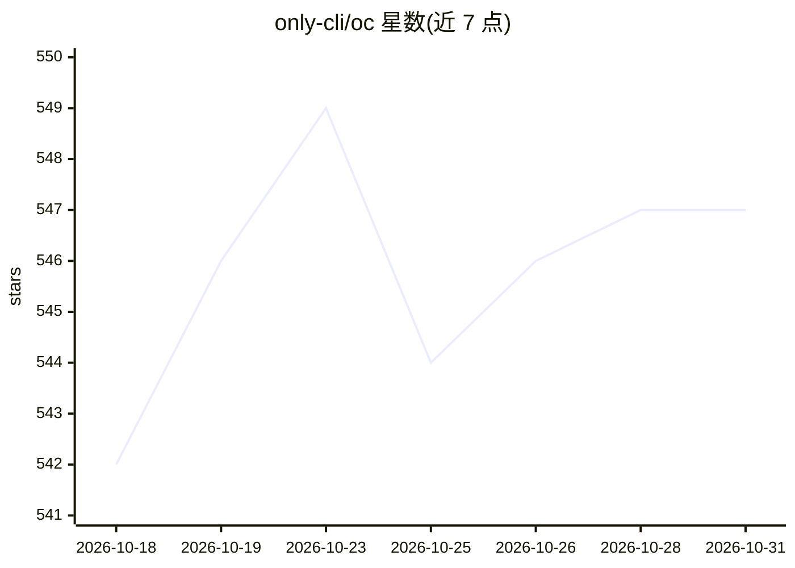

# only-cli/oc

⭐ 547 · JavaScript · MIT · 推送 2026-10-27 · [GitHub](https://github.com/only-cli/oc) · [官网](https://only-cli.com) · 组织维护

**把网页变成紧凑 CLI 供 AI agent 低价浏览的命令行工具**

面向 AI agent（Claude Code、Codex、Antigravity 等）的命令行网页浏览工具：`oc open <url>` 抓取页面并返回带编号的紧凑视图而非原始 HTML 或截图，将典型页面从数万 token 压缩到数百 token；请求通过 impers 模拟 Chrome 身份以通过部分站点对简易抓取器的拦截，必要时降级到 Firefox 或原生 fetch。无需逐站适配、浏览器扩展或守护进程；`clis/` 内置数十个站点快捷命令（HN、GitHub、各语言文档等），可安装为 agent 技能或 Claude Code 插件。要求 Node 20+，与 OpenShift 的 `oc` 命令存在命名冲突。限定了渲染文本是数据而非指令的安全口径。

## 筛选速览

| 维度 | 判定 | 备注 |
|---|---|---|
| AI 角色 | `ai-ecosystem` | LLM/agent 周边工具 |
| 许可风险 | `permissive` | MIT |
| 部署形态 | `library` | 以包/库形式分发 |
| 模型依赖 | — | README 未给出锁定关系 |
| 硬件要求 | — | 无带数字的原话,不猜 |
| 安装摩擦 | `medium` | 含编译或系统依赖之一 |
| 成熟度 | — | 结构信号不足 |

## 能力要点

- `oc open` 将网页渲染为带编号动作的紧凑视图，默认 500 token 预算
- 通过 impers 模拟 Chrome 身份请求，支持降级到 Firefox 或原生 fetch
- `clis/` 提供数十个站点专属快捷命令（HN、GitHub、多语言文档、Docker Hub 等）
- 可安装为 agent 技能、复制技能目录或作为 Claude Code 插件

## 适用场景

- 让 Claude Code / Codex 等 agent 用数百 token 浏览网页而非抓取原始 HTML
- 通过 `oc gh`、`oc npm` 等快捷命令快速查询仓库、依赖与文档信息
- 在 agent 指令文件中加一行即可接入，无需浏览器扩展或守护进程

## 场景标签

`网页抓取` · 领域:效率与自动化

## 证据(README 行号)

> L7: Turns websites into a command line interface for AI agents. `oc open <url>` fetches a page and hands back a compact,
> L40: Add one line to your agent's instructions file (CLAUDE.md, AGENTS.md, or equivalent):
> L42: > When you need content from a web page, run `npx @only-cli/oc open <url>` instead of fetching raw HTML. Run `npx @

## 星数曲线

2026-10-18 542 → 2026-10-31 547（+5）

---
*卡片 v1 · prompt 1.4 · 生成 2026-10-22 · 置信度 mid · 依据 README sha `e6ef47ba04d6` · [字段定义](../../DATASET.md)*
