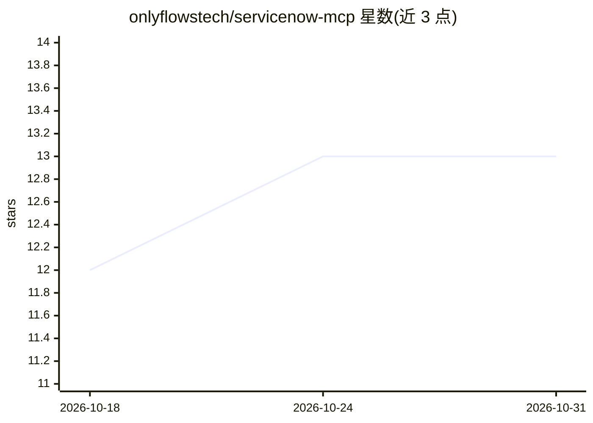

# onlyflowstech/servicenow-mcp

⭐ 13 · TypeScript · MIT · 推送 2026-10-30 · [GitHub](https://github.com/onlyflowstech/servicenow-mcp) · [官网](https://onlyflows.tech) · 组织维护

**面向 ServiceNow 的 MCP 服务器：19 个工具覆盖 CRUD、CMDB 与 ATF**

以 npm 包分发的 ServiceNow MCP 服务器，通过 stdio 被各 MCP 客户端按需拉起，提供 19 个工具覆盖表记录 CRUD、追加式事件日志、CMDB 关系图遍历、后台脚本与 ATF 测试。配套 servicenenow-mcp-setup 向导生成认证材料、校验凭据、配置多实例命名 profile（dev/test/prod/PDI）并按表白名单授权；默认拒绝未配置的表访问，凭据以加密信封或 secret 引用存于 owner-only 目录，客户端不持有凭据。自动注册 Codex 与 Claude Code，支持 Cursor、VS Code、Claude Desktop、Windsurf 等文件配置接入。

## 筛选速览

| 维度 | 判定 | 备注 |
|---|---|---|
| AI 角色 | `ai-ecosystem` | LLM/agent 周边工具 |
| 许可风险 | `permissive` | MIT |
| 部署形态 | `library` | 以包/库形式分发 |
| 模型依赖 | — | README 未给出锁定关系 |
| 硬件要求 | — | 无带数字的原话,不猜 |
| 安装摩擦 | `low` | 无编译、无系统依赖或容器化 |
| 成熟度 | — | 结构信号不足 |

## 能力要点

- 19 个工具：CRUD、追加式事件日志、CMDB 图遍历、后台脚本、ATF 测试
- 多实例命名 profile，每次工具调用显式指定，无默认 profile 回退
- 默认拒绝的表白名单授权模型，凭据加密（AES-256-GCM）或 secret 引用
- servicenow-mcp-setup 一条命令完成引导、客户端注册与诊断（doctor）

## 适用场景

- 让 Claude Code / Codex / Cursor 等 MCP 客户端直接操作 ServiceNow 实例
- 管理 dev/test/prod 多实例凭据并按表做最小权限授权
- 在 MCP 会话中查询事件、遍历 CMDB 关系、执行 ATF 测试

## 场景标签

 · 领域:企业 IT 服务管理（ITSM/ITOM）/MCP 集成

## 证据(README 行号)

> L3: **The most comprehensive ServiceNow MCP server.** 19 tools for full CRUD, append-only incident journals, CMDB graph 
> L33: There is nothing to start. The server speaks **stdio**: each registered client
> L147: - `servicenow-mcp` — the MCP server itself, spawned by a client over stdio

## 星数曲线

2026-10-18 12 → 2026-10-31 13（+1）

---
*卡片 v1 · prompt 1.4 · 生成 2026-10-31 · 置信度 high · 依据 README sha `dea0a2ed8254` · [字段定义](../../DATASET.md)*
