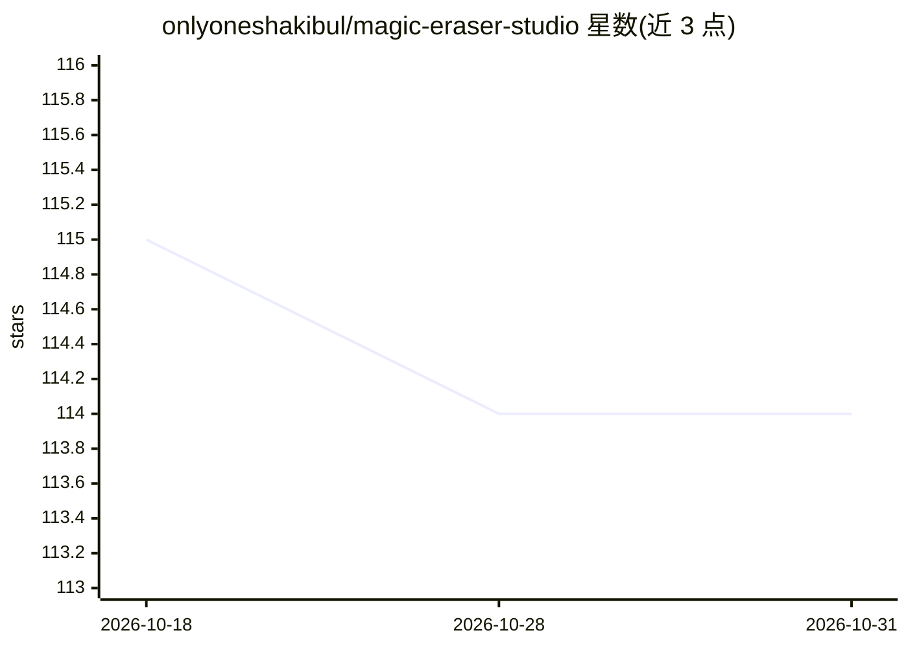

# onlyoneshakibul/magic-eraser-studio

⭐ 114 · HTML · 推送 2026-10-30 · [GitHub](https://github.com/onlyoneshakibul/magic-eraser-studio) · 组织维护

**面向创作者的 AI 图像物体移除（inpainting）网页工具**

PhotoWeaver 是一个基于生成式 inpainting 的图像编辑服务：用户上传照片（最大 50MB，最高支持 40MP）、涂抹选择区域，服务端通过分割、上下文提取、深度感知生成与多尺度混合四个阶段重建被移除区域。支持多点选区、批量处理（最多 50 张）、分支式撤销历史，界面支持 18 种语言。云端服务器端处理，无需本地 GPU。README 声明采用 MIT 许可，同时包含 24/7 客服、付费暗示（拒绝免费/破解话术）等商业服务特征，代码实际开源情况与功能真实性无法从 README 验证。

## 筛选速览

| 维度 | 判定 | 备注 |
|---|---|---|
| AI 角色 | `ai-native` | 本体是模型或模型工具 |
| 许可风险 | `none` | — |
| 部署形态 | `None` |  |
| 模型依赖 | — | README 未给出锁定关系 |
| 硬件要求 | — | 无带数字的原话,不猜 |
| 安装摩擦 | `low` | 无编译、无系统依赖或容器化 |
| 成熟度 | — | 结构信号不足 |

## 能力要点

- 扩散模型 inpainting 管线（分割→上下文提取→深度感知生成→多尺度混合）
- 支持最高 40MP 原生分辨率与批量处理（最多 50 张）
- 分支式撤销历史与多点独立选区
- 云端处理，无需本地 GPU，界面支持 18 种语言

## 适用场景

- 从照片中移除路人、电线等干扰物
- 电商产品图去除价签、条码与反光
- 老照片修复（划痕、水渍、灰尘清理）
- 批量去除系列照片中的相同水印（须持合法授权）

## 场景标签

`图像视频处理` · 领域:感知与多模态

## 证据(README 行号)

> L5: Where pixels become storytellers. PhotoWeaver is not just another image editor—it's an intelligent composition engin
> L11: The core technology—a hybrid of diffusion-based inpainting and edge-aware neural blending—works in concert with a l

## 星数曲线

2026-10-18 115 → 2026-10-31 114（-1）

---
*卡片 v1 · prompt 1.4 · 生成 2026-10-23 · 置信度 mid · 依据 README sha `8af3f09c9a7a` · [字段定义](../../DATASET.md)*
