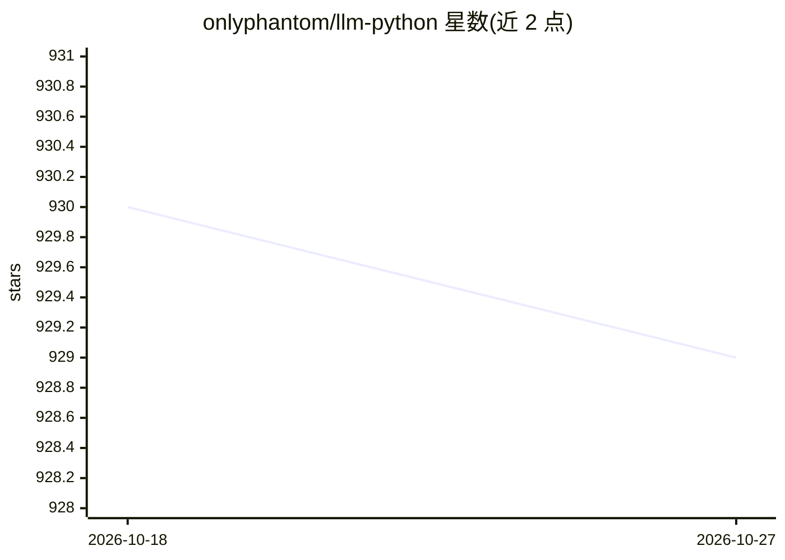

# onlyphantom/llm-python

⭐ 929 · Jupyter Notebook · MIT · 推送 2026-02-20 · [GitHub](https://github.com/onlyphantom/llm-python) · [官网](https://www.youtube.com/playlist?list=PLXsFtK46HZxUQERRbOmuGoqbMD-KWLkOS) · 个人维护

**面向学习者的 LLM 应用与 Agent 开发教程代码集**

由个人维护者（Supertype）提供的 LLM 教学代码仓库：包含 24+ 个自包含 Python 脚本，配套约 9 小时 YouTube 视频课程，覆盖 LangChain、LlamaIndex、OpenAI Agent SDK、Chroma、Pinecone 等接口构建问答系统、RAG、多 Agent 模式（hand-off、tool-use、guardrails 等 6 种）。快速开始方式为克隆仓库后 pip install -r requirements.txt 并配置 .env 中的 API key（OpenAI 必需，HuggingFace/Pinecone/Cohere/Stability 可选）。依赖版本截至 2023-06 更新，作者声明尽力跟进新版本。

## 筛选速览

| 维度 | 判定 | 备注 |
|---|---|---|
| AI 角色 | `ai-knowledge` | 知识聚合/清单类 |
| 许可风险 | `permissive` | MIT |
| 部署形态 | `library` | 以包/库形式分发 |
| 模型依赖 | — | README 未给出锁定关系 |
| 硬件要求 | — | 无带数字的原话,不猜 |
| 安装摩擦 | `low` | 无编译、无系统依赖或容器化 |
| 成熟度 | — | 结构信号不足 |

## 能力要点

- 24+ 个自包含示例脚本，配套 YouTube 视频课程
- 覆盖 6 种 Agent 构建模式（基于 openai-agents SDK）
- 涉及 LangChain/LlamaIndex/Chroma/Pinecone 等多种接口
- 附免费课程与 Supertype Fellowship 导师计划

## 适用场景

- 跟随视频课程学习 LLM 应用与 Agent 开发
- 查找 RAG、function-calling、对话记忆等用法模式作为代码参考
- 按需挑选单个示例自學特定工具链

## 场景标签

`教程课程` · 领域:学习与行业

## 证据(README 行号)

> L3: A set of instructional materials, code samples and Python scripts featuring LLMs (GPT etc) through interfaces like l
> L5: The code examples are aimed at helping you learn how to build LLM applications and Agents using Python. The code is 
> L11: Learn LangChain from my YouTube channel (~9 hours of LLM hands-on building tutorials); Each lesson is accompanied b

## 星数曲线

2026-10-18 930 → 2026-10-27 929（-1）

---
*卡片 v1 · prompt 1.4 · 生成 2026-10-21 · 置信度 high · 依据 README sha `58cb82f13833` · [字段定义](../../DATASET.md)*
