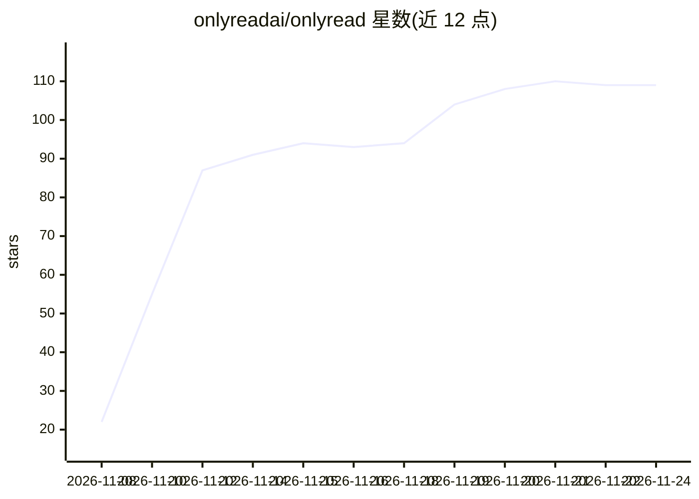

# onlyreadai/onlyread

⭐ 109 · TypeScript · AGPL-3.0 · 推送 2026-11-23 · [GitHub](https://github.com/onlyreadai/onlyread) · [官网](https://onlyread.ai) · 组织维护

**让 AI 浏览器代理只读的 Chrome 扩展：拦截发送前的写操作**

面向让 AI 代理操作真实登录账号的用户，OnlyRead 是一个 Chrome MV3 扩展，在网络层拒绝代理发出的 send、post、edit、delete 等写请求，读取放行。机制分四层：基础规则直接拒绝纯写方法、针对 Gmail/LinkedIn/Facebook 等单一端点应用的站点解码器、预审核判定缓存，剩余请求交给 AI judge（OpenRouter/Vercel AI Gateway 自备 key 或 OnlyRead Pro 服务，含 1000 次免费判定）。基于 Chrome debugger API，附件时浏览器显示调试横幅；不支持 Firefox/Safari。覆盖任意驱动 Chromium 浏览器的代理，已在 100+ 站点测试。

## 筛选速览

| 维度 | 判定 | 备注 |
|---|---|---|
| AI 角色 | `ai-ecosystem` | LLM/agent 周边工具 |
| 许可风险 | `viral` | AGPL-3.0 |
| 部署形态 | `desktop` | 安装包/桌面程序 |
| 模型依赖 | — | README 未给出锁定关系 |
| 硬件要求 | — | 无带数字的原话,不猜 |
| 安装摩擦 | `low` | 无编译、无系统依赖或容器化 |
| 成熟度 | — | 结构信号不足 |

## 能力要点

- 在模型之下的网络层强制只读，代理工作中无法关闭或降低其设置
- 四层判定：规则→站点解码器→判定缓存→AI judge（不确定即拒绝）
- judge 仅见请求地址与脱敏预览，不含 cookies/headers/响应
- 100+ 站点测试，未测试站点也经同一规则与 judge 处理

## 适用场景

- 把真实邮箱、日历交给浏览器代理时防止误写或提示注入导致的写操作
- 让代理执行收件箱分诊、摘要、找发票等只读任务
- Always 模式下让自己日常浏览也处于写保护

## 场景标签

`网络安全` · 领域:学习与行业

## 证据(README 行号)

> L5: The **read-only mode** for AI agents in the browser. Hand any agent that drives your
> L31: Asking the model to be careful is not a guarantee. **OnlyRead enforces it below the model**, at the
> L76: OnlyRead guards the browser, not a particular agent. Any agent that acts in a Chromium browser with OnlyRead

## 星数曲线

2026-11-08 22 → 2026-11-24 109（+87）

---
*卡片 v1 · prompt 1.4 · 生成 2026-11-17 · 置信度 high · 依据 README sha `191daf7c5d65` · [字段定义](../../DATASET.md)*
