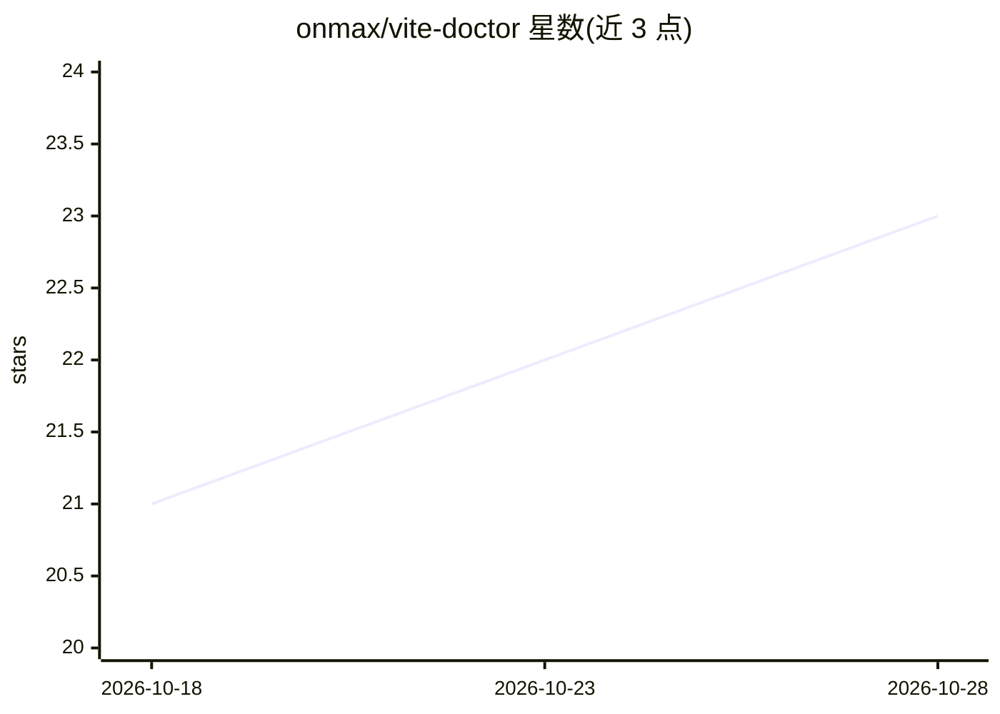

# onmax/vite-doctor

⭐ 22 · TypeScript · MIT · 推送 2026-10-27 · [GitHub](https://github.com/onmax/vite-doctor) · [官网](https://vite-doctor.onmax.me) · 个人维护

**面向 AI agent 代码的 Nuxt/Vue/Vite/Nitro 框架缺陷诊断工具**

命令行与插件形式的静态诊断工具：读取应用代码、构建配置、项目元数据与服务端 handler，解析已安装的 Nuxt/Nitro/H3 运行时依赖图，按实际加载版本选择规则，输出框架缺陷诊断。支持 --changed/--since 增量模式、多种输出格式（text/agent/json/sarif）、依赖迁移检查报告与 doctor.config 声明式配置；可识别 coding-agent 运行时并返回含修复建议与命令模板的紧凑 agent 报告，供自动化执行。供使用 Nuxt/Vue/Nitro/Vite 栈的开发者与 AI agent 工作流在 CI 或提交前检查代码。

## 筛选速览

| 维度 | 判定 | 备注 |
|---|---|---|
| AI 角色 | `ai-ecosystem` | LLM/agent 周边工具 |
| 许可风险 | `permissive` | MIT |
| 部署形态 | `library` | 以包/库形式分发 |
| 模型依赖 | — | README 未给出锁定关系 |
| 硬件要求 | — | 无带数字的原话,不猜 |
| 安装摩擦 | `low` | 无编译、无系统依赖或容器化 |
| 成熟度 | — | 结构信号不足 |

## 能力要点

- 解析已安装 Nuxt/Nitro/H3 运行时依赖图并按实际版本选择诊断规则
- --changed/--since 按 git 变更行过滤报告
- 输出 text/agent/json/sarif 格式，agent 报告含 remediation 与可执行 commandArgs
- migrate 子命令生成 nuxt@5/nitro@3 等迁移分阶段报告

## 适用场景

- CI 中在构建前运行，拦截 AI agent 产出的框架缺陷
- 为 coding agent 提供机器可执行的诊断报告以自动修复
- 升级 Nuxt/Nitro 前检查迁移所需的依赖与源码变更

## 场景标签

 · 领域:前端/Web 开发工具

## 证据(README 行号)

> L36: Doctor recognizes coding-agent runtimes through Vercel's agent catalog and returns a compact agent report when outp
> L45: Agent reports use relative locations and include remediation, Diagnostic Reference URLs, and command templates for 

## 星数曲线

2026-10-18 21 → 2026-10-28 23（+2）

---
*卡片 v1 · prompt 1.4 · 生成 2026-10-27 · 置信度 mid · 依据 README sha `3b333bf8de59` · [字段定义](../../DATASET.md)*
