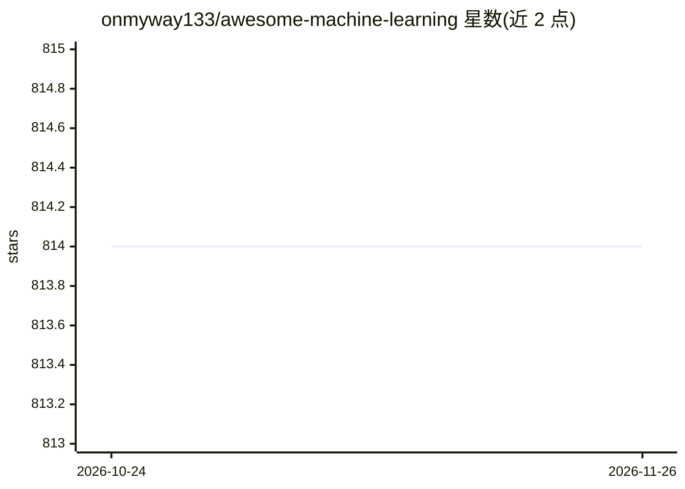

# onmyway133/awesome-machine-learning

⭐ 814 · MIT · 推送 2026-10-27 · [GitHub](https://github.com/onmyway133/awesome-machine-learning) · [官网](https://onmyway133.com) · 个人维护

**面向 Swift/iOS 开发者的机器学习资源清单（Core ML 为主）**

由个人维护的机器学习资源策展清单，按 Core ML、TensorFlow、Keras、Turi Create、Vision、NLP、Metal、GamePlayKit、Courses、Services 等分类组织条目，覆盖预训练模型仓库、模型转换工具（coremltools、onnx-coreml、tf-coreml）、教程文章、示例工程与学习课程。核心围绕 Apple Core ML 与 Swift 生态，收录其他平台条目供参考。仓库本身不含代码功能，无安装与运行步骤，仅以链接列表形式提供资源索引。

## 筛选速览

| 维度 | 判定 | 备注 |
|---|---|---|
| AI 角色 | `ai-knowledge` | 知识聚合/清单类 |
| 许可风险 | `permissive` | MIT |
| 部署形态 | `None` |  |
| 模型依赖 | — | README 未给出锁定关系 |
| 硬件要求 | — | 无带数字的原话,不猜 |
| 安装摩擦 | `low` | 无编译、无系统依赖或容器化 |
| 成熟度 | — | 结构信号不足 |

## 能力要点

- 按 Core ML/TensorFlow/Keras/Vision 等分类组织的资源索引
- 收录 Core ML 模型库与模型格式转换工具清单
- 含教程文章、示例工程与课程链接

## 适用场景

- 为 iOS/macOS 应用查找 Core ML 预训练模型
- 寻找模型转 Core ML 格式的工具
- 系统学习 Swift 环境下的机器学习入门资料

## 场景标签

`精选清单` · 领域:学习与行业

## 证据(README 行号)

> L1: # awesome-machine-learning Awesome
> L13: I like to explore machine learning, but don't want the to dive into other platforms, like Python or Javascript, to 
> L15: This will curates things mostly related to Core ML, and Swift. There are related things in other platforms if you w

## 星数曲线

2026-10-24 814 → 2026-11-26 814（+0）

---
*卡片 v1 · prompt 1.4 · 生成 2026-11-24 · 置信度 high · 依据 README sha `24c2ee9c9180` · [字段定义](../../DATASET.md)*
