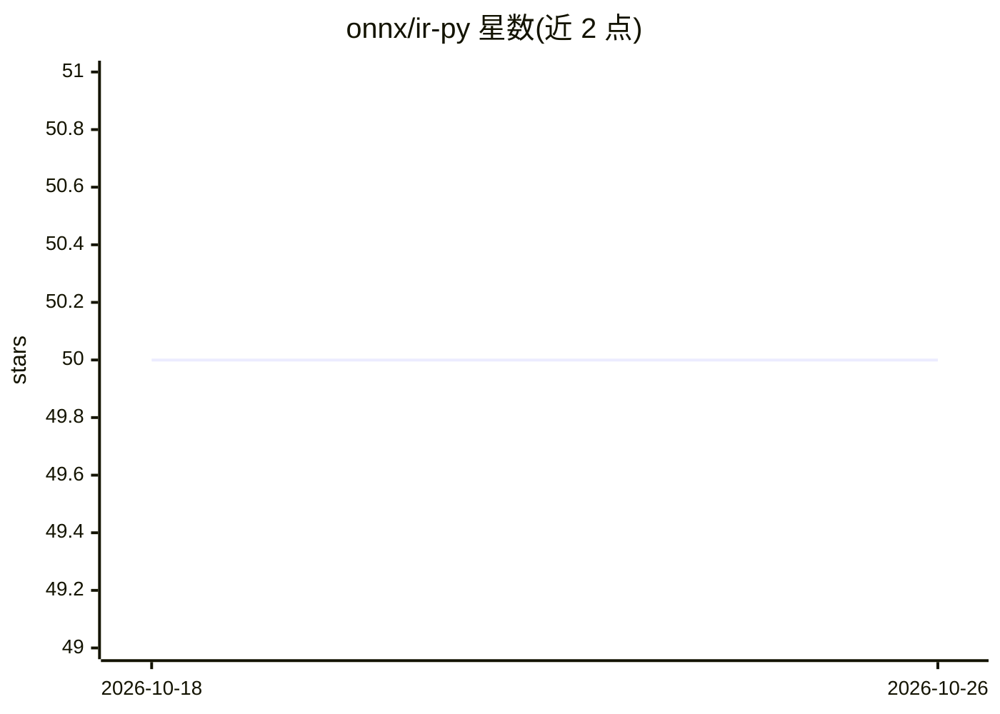

# onnx/ir-py

⭐ 50 · Python · Apache-2.0 · 推送 2026-10-25 · [GitHub](https://github.com/onnx/ir-py) · [官网](http://onnx.ai/ir-py/) · 组织维护

**Python 内存 IR 库：完整支持 ONNX 规范的图构建与变换**

onnx/ir-py 提供 ONNX 模型的内存中间表示（IR），覆盖完整 ONNX 规范，面向图构建、分析与变换场景。机制上：通过 mmap 外部张量与零拷贝降低内存占用，统一接口封装 TensorProto/Numpy/PyTorch Tensor 等多种张量类型且无大小限制；转为 IR 后不再依赖 protobuf，与序列化格式解耦；支持在变更图结构的同时安全迭代。以 Python 包（pip / 源码安装）形式提供给模型编译与优化工具链开发者使用。

## 筛选速览

| 维度 | 判定 | 备注 |
|---|---|---|
| AI 角色 | `ai-ecosystem` | LLM/agent 周边工具 |
| 许可风险 | `permissive` | Apache-2.0 |
| 部署形态 | `library` | 以包/库形式分发 |
| 模型依赖 | — | README 未给出锁定关系 |
| 硬件要求 | — | 无带数字的原话,不猜 |
| 安装摩擦 | `low` | 无编译、无系统依赖或容器化 |
| 成熟度 | — | 结构信号不足 |

## 能力要点

- 完整 ONNX 规范支持，且可加载部分无效模型以便修复
- mmap 外部张量、零拷贝、无张量大小限制的统一张量接口
- 转为 IR 后不依赖 protobuf，与序列化格式解耦
- 支持图结构变更期间的安全迭代

## 适用场景

- 编写 ONNX 模型的图变换与优化 pass
- 分析模型图结构与值信息
- 低内存方式加载与修复超大 ONNX 模型

## 场景标签

 · 领域:机器学习基础设施/模型编译

## 证据(README 行号)

> L8: An in-memory IR that supports the full ONNX spec, designed for graph construction, analysis and transformation.
> L30: - Full ONNX spec support: all valid models representable by ONNX protobuf, and a subset of invalid models (so you c

## 星数曲线

2026-10-18 50 → 2026-10-26 50（+0）

---
*卡片 v1 · prompt 1.4 · 生成 2026-10-24 · 置信度 high · 依据 README sha `0a5b93a0df47` · [字段定义](../../DATASET.md)*
