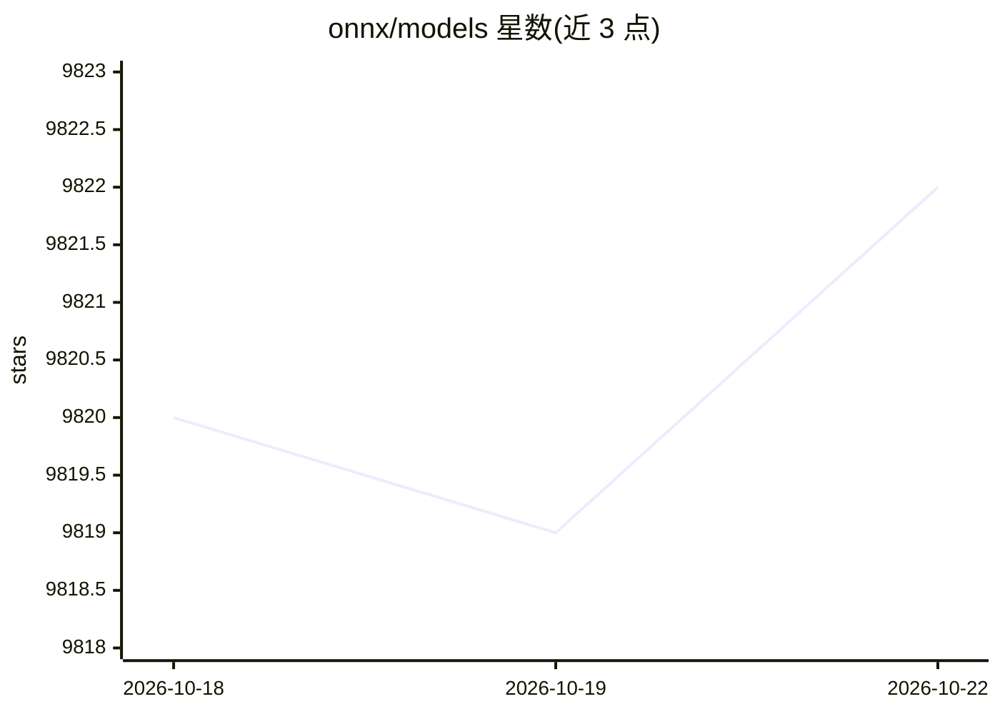

# onnx/models

⭐ 9,822 · Jupyter Notebook · Apache-2.0 · 推送 2026-10-03 · [GitHub](https://github.com/onnx/models) · 组织维护

**ONNX 格式预训练模型集合，供开发者下载使用**

ONNX 官方维护的预训练模型动物园：以 ONNX 开放格式收录图像分类、目标检测与分割、人脸/人体分析、图像处理、语音音频、NLP 等类别的模型，模型文件通过 Git LFS 分发，部分 INT8 量化模型由 Intel Neural Compressor 生成。仓库已发布弃用公告：仅作历史保存，2025 年 7 月 1 日起模型不再提供 LFS 下载，可转至 Hugging Face 上的 onnxmodelzoo 获取原模型。

## 筛选速览

| 维度 | 判定 | 备注 |
|---|---|---|
| AI 角色 | `ai-knowledge` | 知识聚合/清单类 |
| 许可风险 | `permissive` | Apache-2.0 |
| 部署形态 | `library` | 以包/库形式分发 |
| 模型依赖 | — | README 未给出锁定关系 |
| 硬件要求 | — | 无带数字的原话,不猜 |
| 安装摩擦 | `low` | 无编译、无系统依赖或容器化 |
| 成熟度 | — | 结构信号不足 |

## 能力要点

- 收录图像分类、目标检测/分割、人脸/人体分析、语音等多类别预训练模型
- 模型文件经 Git LFS 分发，附验证用测试数据与 Python 示例
- INT8 量化模型由 Intel Neural Compressor 生成
- 已宣布弃用，模型迁移至 Hugging Face onnxmodelzoo

## 适用场景

- 查找并下载 ONNX 格式的预训练模型用于推理部署
- 在模型发布到 Hugging Face 前获取历史 ONNX 模型存档
- 用提供的测试数据验证 ONNX 模型精度

## 场景标签

 · 领域:深度学习/模型分发

## 证据(README 行号)

> L9: This repository is a curated collection of pre-trained, state-of-the-art models in the ONNX format. These models are
> L15: Currently, we are expanding the ONNX Model Zoo by incorporating additional models from the following categories.

## 星数曲线

2026-10-18 9,820 → 2026-10-22 9,822（+2）

---
*卡片 v1 · prompt 1.4 · 生成 2026-10-20 · 置信度 mid · 依据 README sha `65400827238c` · [字段定义](../../DATASET.md)*
