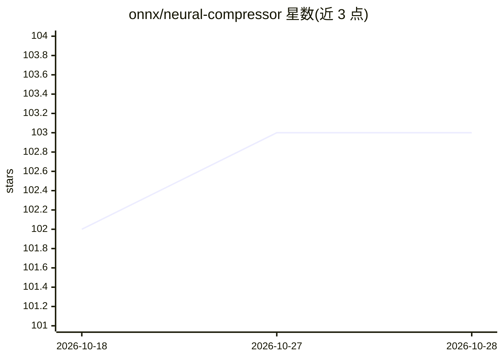

# onnx/neural-compressor

⭐ 103 · Python · Apache-2.0 · 推送 2026-05-01 · [GitHub](https://github.com/onnx/neural-compressor) · 组织维护

**面向 ONNX 模型的量化压缩 Python 库**

开源 Python 库，继承 Intel Neural Compressor 的压缩技术并聚焦 ONNX 模型量化：通过 ONNX Runtime 提供 SmoothQuant、INT8/INT4 权重量化（RTN）、Layer-Wise 量化与静态量化等能力，含自动精度驱动的量化策略。验证过的模型覆盖 Llama2/Llama3/Qwen2 及 BERT-base、ResNet50 等来自 Hugging Face 与 ONNX Model Zoo 的模型。注意 README 提示正式 pypi 发布前需从源码安装。面向使用 ONNX Runtime 部署模型的开发与优化人员。

## 筛选速览

| 维度 | 判定 | 备注 |
|---|---|---|
| AI 角色 | `ai-ecosystem` | LLM/agent 周边工具 |
| 许可风险 | `permissive` | Apache-2.0 |
| 部署形态 | `library` | 以包/库形式分发 |
| 模型依赖 | — | README 未给出锁定关系 |
| 硬件要求 | — | 无带数字的原话,不猜 |
| 安装摩擦 | `low` | 无编译、无系统依赖或容器化 |
| 成熟度 | `idea` | |

## 能力要点

- SmoothQuant、INT8/INT4 权重量化、Layer-Wise 量化等压缩技术
- 基于 ONNX Runtime 执行量化，设备可自动选择
- 自动精度驱动的量化策略，验证过 Llama2/Llama3/Qwen2/BERT/ResNet50 等模型

## 适用场景

- 对 LLM 或常见模型做 INT8/INT4 量化以压缩部署
- 在 ONNX Runtime 生态中执行静态量化与 SmoothQuant
- 从 Hugging Face / ONNX Model Zoo 拉取模型做精度驱动量化验证

## 场景标签

`模型量化` · 领域:训练与推理

## 证据(README 行号)

> L8: Neural Compressor aims to provide popular model compression techniques inherited from Intel Neural Compressor yet fo
> L33: pip install onnx-neural-compressor "onnxruntime>=1.17.0" onnx

## 星数曲线

2026-10-18 102 → 2026-10-28 103（+1）

---
*卡片 v1 · prompt 1.4 · 生成 2026-10-23 · 置信度 high · 依据 README sha `a960e5673594` · [字段定义](../../DATASET.md)*
