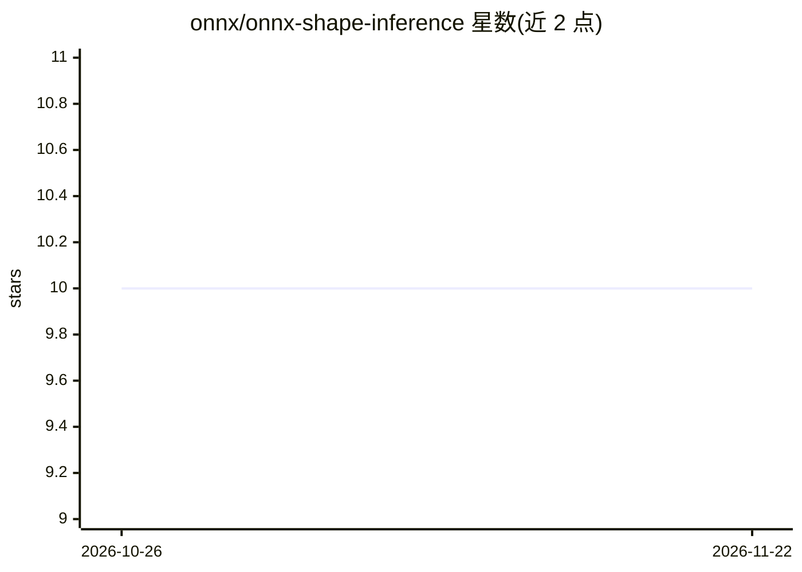

# onnx/onnx-shape-inference

⭐ 10 · Python · Apache-2.0 · 推送 2026-11-18 · [GitHub](https://github.com/onnx/onnx-shape-inference) · [官网](https://pypi.org/project/onnx-shape-inference/) · 个人维护

**ONNX 模型的符号形状推理库，直接在 IR 上推算张量形状**

基于 ONNX IR 的实验性符号形状推理工具，无需序列化即可在图上传播形状，用 SymPy 做符号维度运算。支持标准 ai.onnx 算子与 com.microsoft 贡献算子的跨 opset 版本分发、形状张量元素值传播（sym_data）、声明符号名的约束消解（如 2*_d0→2*batch）、自定义算子注册与四种合并策略。提供 Python API 与 onnx-shape-inference 命令行，可配合 onnxscript optimizer 使用；带确定性 fuzzer 回归测试。Apache-2.0 许可。

## 筛选速览

| 维度 | 判定 | 备注 |
|---|---|---|
| AI 角色 | `ai-ecosystem` | LLM/agent 周边工具 |
| 许可风险 | `permissive` | Apache-2.0 |
| 部署形态 | `library` | 以包/库形式分发 |
| 模型依赖 | — | README 未给出锁定关系 |
| 硬件要求 | — | 无带数字的原话,不猜 |
| 安装摩擦 | `low` | 无编译、无系统依赖或容器化 |
| 成熟度 | — | 结构信号不足 |

## 能力要点

- 基于 ONNX IR 的符号形状推理，SymPy 符号维度运算，无序列化开销
- 形状张量元素值传播（sym_data），解析 Reshape 等链路的具体输出形状
- 约束消解将匿名符号重命名为作者声明的符号名
- 可注册自定义算子推理函数，提供 strict/override 等四种合并策略

## 适用场景

- 模型优化前推算动态维度形状，帮助 onnxscript optimizer 发现更多优化机会
- 调试自定义 ONNX 算子的形状传播
- 核对模型输出符号名与作者声明的 value_info 是否一致

## 场景标签

 · 领域:机器学习/模型工具链

## 证据(README 行号)

> L9: Experimental symbolic shape inference for ONNX models. Built on top of ONNX IR, this library performs shape inferenc
> L72: You can run symbolic shape inference on the model to help the optimizer discover more optimization opportunities.

## 星数曲线

2026-10-26 10 → 2026-11-22 10（+0）

---
*卡片 v1 · prompt 1.4 · 生成 2026-11-19 · 置信度 high · 依据 README sha `f283953420f6` · [字段定义](../../DATASET.md)*
