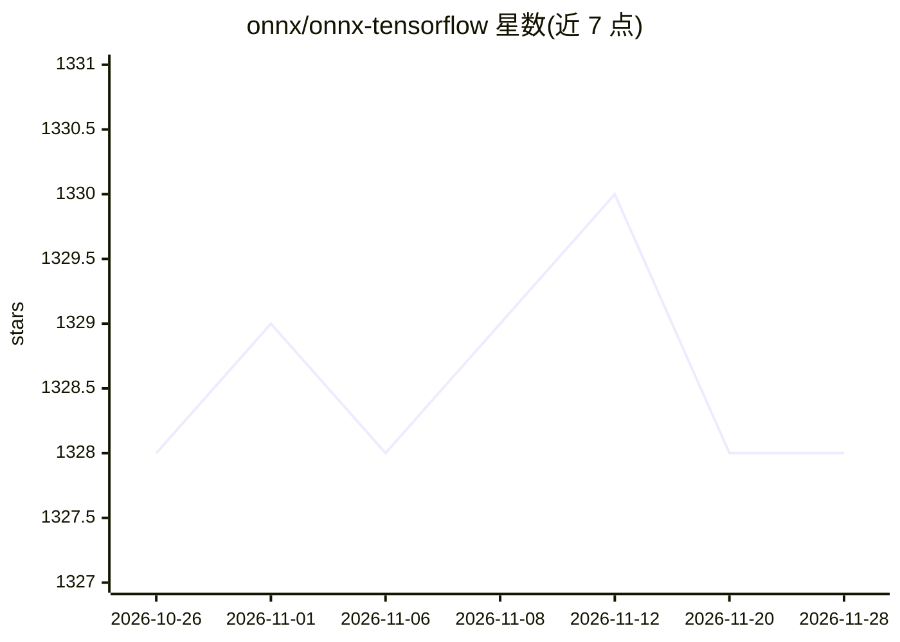

# onnx/onnx-tensorflow

⭐ 1,328 · Python · Apache-2.0 · 推送 2026-11-20 · [GitHub](https://github.com/onnx/onnx-tensorflow) · 组织维护

**将 ONNX 模型转换为 TensorFlow 运行的后端（已归档）**

ONNX-TF 提供 ONNX 模型到 TensorFlow 的转换，并作为 ONNX backend 通过 TensorFlow 运行模型。项目已归档：最终版本为 2022 年 3 月发布的 1.10.0，最终自动化测试环境为 ONNX 1.10.2、TensorFlow 2.8.0、Python 3.8-3.9；不再提供兼容性更新、缺陷修复或安全修复。README 建议运行 ONNX 模型改用 ONNX Runtime，转换需求参考社区维护的 onnx2tf；历史文档保留在 doc/ 与仓库 wiki。

## 筛选速览

| 维度 | 判定 | 备注 |
|---|---|---|
| AI 角色 | `ai-ecosystem` | LLM/agent 周边工具 |
| 许可风险 | `permissive` | Apache-2.0 |
| 部署形态 | `None` |  |
| 模型依赖 | — | README 未给出锁定关系 |
| 硬件要求 | — | 无带数字的原话,不猜 |
| 安装摩擦 | `low` | 无编译、无系统依赖或容器化 |
| 成熟度 | — | 结构信号不足 |

## 能力要点

- 将 ONNX 模型转换为 TensorFlow 并暴露 ONNX backend 运行
- 最终版本 1.10.0（2022 年 3 月），测试环境 ONNX 1.10.2 / TF 2.8.0 / Python 3.8-3.9
- 历史文档保留：命令行参考、Python API、算子支持表
- Apache License 2.0 许可

## 适用场景

- 查阅历史版本的 ONNX 到 TensorFlow 转换实现
- 评估旧模型转换结果的历史复现
- 寻找接手维护该项目的社区信息

## 场景标签

 · 领域:深度学习/模型转换工具

## 证据(README 行号)

> L9: ONNX-TF converted ONNX models to TensorFlow and exposed an ONNX backend for
> L4: > This project is no longer maintained and is being archived.

## 星数曲线

2026-10-26 1,328 → 2026-11-28 1,328（+0）

---
*卡片 v1 · prompt 1.4 · 生成 2026-11-23 · 置信度 high · 依据 README sha `e5457f34fc73` · [字段定义](../../DATASET.md)*
