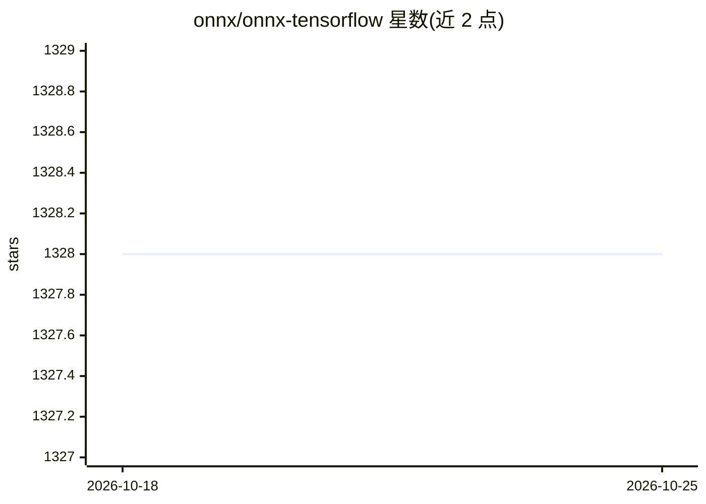

# onnx/onnx-tensorflow

⭐ 1,328 · Python · NOASSERTION · 推送 2026-08-23 · [GitHub](https://github.com/onnx/onnx-tensorflow) · 组织维护

**将 ONNX 模型转换为 TensorFlow 模型的转换器（已宣布弃用）**

ONNX 官方生态中的 TensorFlow 后端项目：把 ONNX 格式模型转换为 TensorFlow 模型，再交由 TensorFlow 执行产出输出；也可通过 backend.prepare 直接加载 ONNX 模型推理。提供 CLI（onnx-tf convert）与 Python API 两种方式。要求 TensorFlow == 2.8.0 且不自动安装 TensorFlow，由用户自行选择 CPU/GPU 变体。README 明确声明该仓库不再积极维护并将弃用，前端代码已合并到 tensorflow-onnx，建议用户迁移。面向使用 TensorFlow 运行 ONNX 模型的开发者。

## 筛选速览

| 维度 | 判定 | 备注 |
|---|---|---|
| AI 角色 | `ai-ecosystem` | LLM/agent 周边工具 |
| 许可风险 | `none` | NOASSERTION |
| 部署形态 | `library` | 以包/库形式分发 |
| 模型依赖 | — | README 未给出锁定关系 |
| 硬件要求 | — | 无带数字的原话,不猜 |
| 安装摩擦 | `low` | 无编译、无系统依赖或容器化 |
| 成熟度 | — | 结构信号不足 |

## 能力要点

- ONNX → TensorFlow 模型转换（CLI 与 Python API 两种方式）
- backend.prepare 支持直接加载 ONNX 模型在 TensorFlow 上推理
- 明确要求 TensorFlow == 2.8.0，不自动安装 TensorFlow
- 官方声明不再维护并将弃用，建议迁移到 tf-onnx

## 适用场景

- 把手头的 ONNX 模型转成 TensorFlow 模型继续训练或部署
- 在 TensorFlow 技术栈内直接运行 ONNX 模型做推理
- 需要批量验证 ONNX Model Zoo 模型可转换性的场景

## 场景标签

 · 领域:深度学习/模型互操作

## 证据(README 行号)

> L9: TensorFlow Backend for ONNX makes it possible to use ONNX models as input for TensorFlow. The ONNX model is first co
> L31: ## ONNX Model Inference with TensorFlow Backend

## 星数曲线

2026-10-18 1,328 → 2026-10-25 1,328（+0）

---
*卡片 v1 · prompt 1.4 · 生成 2026-10-21 · 置信度 high · 依据 README sha `9bf8c8d97528` · [字段定义](../../DATASET.md)*
