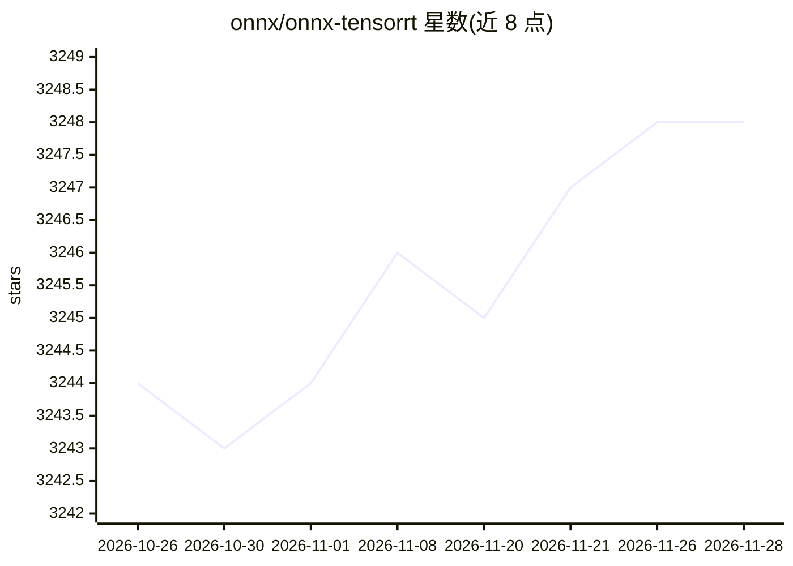

# onnx/onnx-tensorrt

⭐ 3,248 · C++ · Apache-2.0 · 推送 2026-11-19 · [GitHub](https://github.com/onnx/onnx-tensorrt) · 组织维护

**ONNX 模型的 TensorRT 后端解析器，供开发者转换运行**

解析 ONNX 模型以在 TensorRT 上执行的解析器库，由 NVIDIA 维护，当前分支面向 TensorRT 11.5。提供 C++ 库（libnvonnxparser.so，头文件 NvOnnxParser.h）与 Python 绑定（.whl / setup.py 安装），配套 trtexec 与 polygraphy 两个官方工具用于解析并构建 TensorRT engine。支持 ONNX 1.22.0，内置 InstanceNormalization 的 native 与 plugin 两种实现，可通过 kNATIVE_INSTANCENORM 标志切换；附 ONNX backend 测试脚本。构建依赖 CUDA，建议参照 TensorRT 主仓库的构建说明。

## 筛选速览

| 维度 | 判定 | 备注 |
|---|---|---|
| AI 角色 | `ai-ecosystem` | LLM/agent 周边工具 |
| 许可风险 | `permissive` | Apache-2.0 |
| 部署形态 | `library` | 以包/库形式分发 |
| 模型依赖 | — | README 未给出锁定关系 |
| 硬件要求 | — | 无带数字的原话,不猜 |
| 安装摩擦 | `high` | 编译与系统依赖俱全 |
| 成熟度 | — | 结构信号不足 |

## 能力要点

- 提供 C++ 解析库与 Python 绑定两种接入方式
- trtexec 与 polygraphy 工具可直接解析并构建 ONNX 模型
- InstanceNormalization 支持通过解析器标志切换两种实现
- 附 onnx_backend_test.py 后端测试脚本

## 适用场景

- 把 ONNX 格式模型转换成 TensorRT engine 用于推理
- 验证某个 ONNX 模型能否被 TensorRT 解析和构建
- 在 Python 中通过 backend 接口用 TensorRT 执行 ONNX 模型

## 场景标签

`推理引擎` · 领域:训练与推理

## 证据(README 行号)

> L3: Parses ONNX models for execution with TensorRT.
> L35: For building within Docker or on Windows, we recommend using the build instructions in the main TensorRT repository
> L81: Python bindings for the ONNX-TensorRT parser are packaged in the shipped `.whl` files.

## 星数曲线

2026-10-26 3,244 → 2026-11-28 3,248（+4）

---
*卡片 v1 · prompt 1.4 · 生成 2026-11-23 · 置信度 mid · 依据 README sha `4c66e5f8e665` · [字段定义](../../DATASET.md)*
