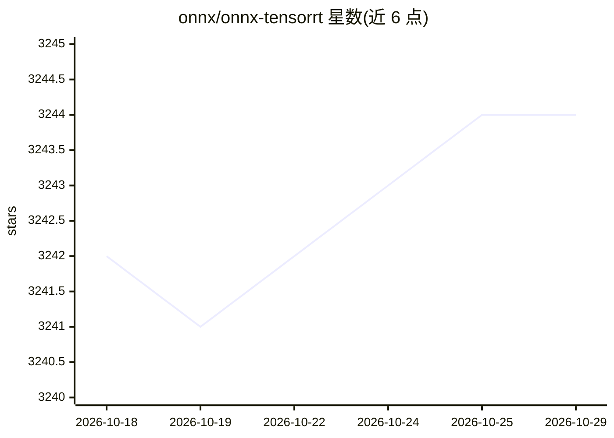

# onnx/onnx-tensorrt

⭐ 3,244 · C++ · Apache-2.0 · 推送 2026-10-09 · [GitHub](https://github.com/onnx/onnx-tensorrt) · 组织维护

**将 ONNX 模型解析为 TensorRT 引擎的解析器后端**

ONNX 的 TensorRT 后端实现：解析 ONNX 模型并构建 TensorRT 引擎用于执行，提供 C++ 解析器库 libnvonnxparser、Python 绑定及 Python 后端接口。支持动态 shape，当前分支面向 TensorRT 11.4 与 ONNX 1.21.0。需从源码用 CMake 编译构建，依赖 CUDA 工具链；另提供 trtexec 与 polygraphy 两个官方工具用于快速验证 ONNX 模型能否解析并构建引擎。InstanceNormalization 提供原生与插件两种实现可选。

## 筛选速览

| 维度 | 判定 | 备注 |
|---|---|---|
| AI 角色 | `ai-ecosystem` | LLM/agent 周边工具 |
| 许可风险 | `permissive` | Apache-2.0 |
| 部署形态 | `library` | 以包/库形式分发 |
| 模型依赖 | — | README 未给出锁定关系 |
| 硬件要求 | — | 无带数字的原话,不猜 |
| 安装摩擦 | `high` | 编译与系统依赖俱全 |
| 成熟度 | — | 结构信号不足 |

## 能力要点

- 解析 ONNX 模型并构建 TensorRT 引擎，含 C++ 库与 Python 绑定
- 支持 full-dimensions 与动态 shape
- trtexec / polygraphy 两个官方工具快速验证模型可解析性
- InstanceNormalization 提供原生与插件两种实现切换

## 适用场景

- 把已导出的 ONNX 模型部署到 TensorRT 推理引擎
- 验证 ONNX 模型在 TensorRT 上的算子支持情况
- 在 C++ 或 Python 中集成 ONNX 解析能力

## 场景标签

`推理引擎` · 领域:训练与推理

## 证据(README 行号)

> L3: Parses ONNX models for execution with TensorRT.
> L29:  - TensorRT 11.4

## 星数曲线

2026-10-18 3,242 → 2026-10-29 3,244（+2）

---
*卡片 v1 · prompt 1.4 · 生成 2026-10-21 · 置信度 mid · 依据 README sha `83fb6aed906b` · [字段定义](../../DATASET.md)*
