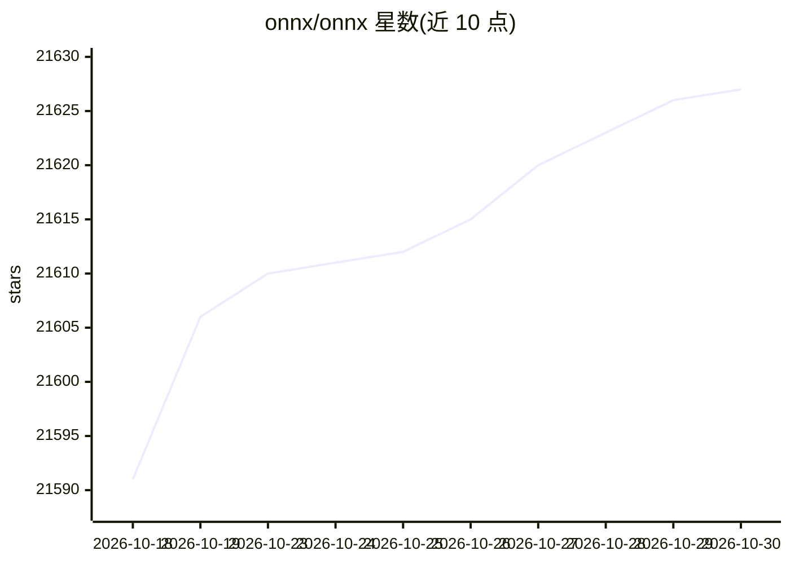

# onnx/onnx

⭐ 21,627 · Python · Apache-2.0 · 推送 2026-10-29 · [GitHub](https://github.com/onnx/onnx) · [官网](https://onnx.ai/) · 组织维护

**给 AI 开发者的跨框架模型互操作开放格式标准**

ONNX 定义 AI 模型的开源格式，覆盖深度学习与传统 ML：采用可扩展计算图模型，内置算子与标准数据类型定义，当前聚焦推理能力。提供 Python 包及图处理工具（形状/类型推断、图优化、opset 版本转换）、中间表示规范文档与预训练模型资源。由社区开放治理维护，含 SIG、工作组与年度社区聚会，包以 abi3 兼容 wheel 发布，构建流程支持可复现构建。

## 筛选速览

| 维度 | 判定 | 备注 |
|---|---|---|
| AI 角色 | `ai-ecosystem` | LLM/agent 周边工具 |
| 许可风险 | `permissive` | Apache-2.0 |
| 部署形态 | `library` | 以包/库形式分发 |
| 模型依赖 | — | README 未给出锁定关系 |
| 硬件要求 | — | 无带数字的原话,不猜 |
| 安装摩擦 | `low` | 无编译、无系统依赖或容器化 |
| 成熟度 | — | 结构信号不足 |

## 动量与使用信号

- 维护:`active` — 距上次 push 1.4 天,年发版 7,402 位贡献者
- 涨星:近 1 天 **+2**(自 20261016 起算)
- 安装:pypi 包 `onnx` 月下载 13,120,943

## 能力要点

- 可扩展计算图模型与内置算子、标准数据类型定义
- 图处理工具：形状/类型推断、图优化、opset 版本转换
- abi3 兼容 wheel，单个二进制适配多个 Python 版本（3.12 起）
- 构建发布流程设置 SOURCE_DATE_EPOCH 支持可复现构建

## 适用场景

- 在不同框架间交换和部署训练好的模型
- 查阅 ONNX 算子与中间表示规范做工具开发
- 从源码构建并校验 ONNX 包的可复现性

## 场景标签

 · 领域:机器学习基础设施/模型互操作标准

## 证据(README 行号)

> L10: Open Neural Network Exchange (ONNX) is an open ecosystem that empowers AI developers
> L11: to choose the right tools as their project evolves. ONNX provides an open source format for AI models, both deep le
> L74: pip install onnx # or pip install onnx[reference] for optional reference implementation dependencies

## 星数曲线

2026-10-18 21,591 → 2026-10-30 21,627（+36）

---
*卡片 v1 · prompt 1.4 · 生成 2026-10-18 · 置信度 high · 依据 README sha `2c8dc756e41d` · [字段定义](../../DATASET.md)*
