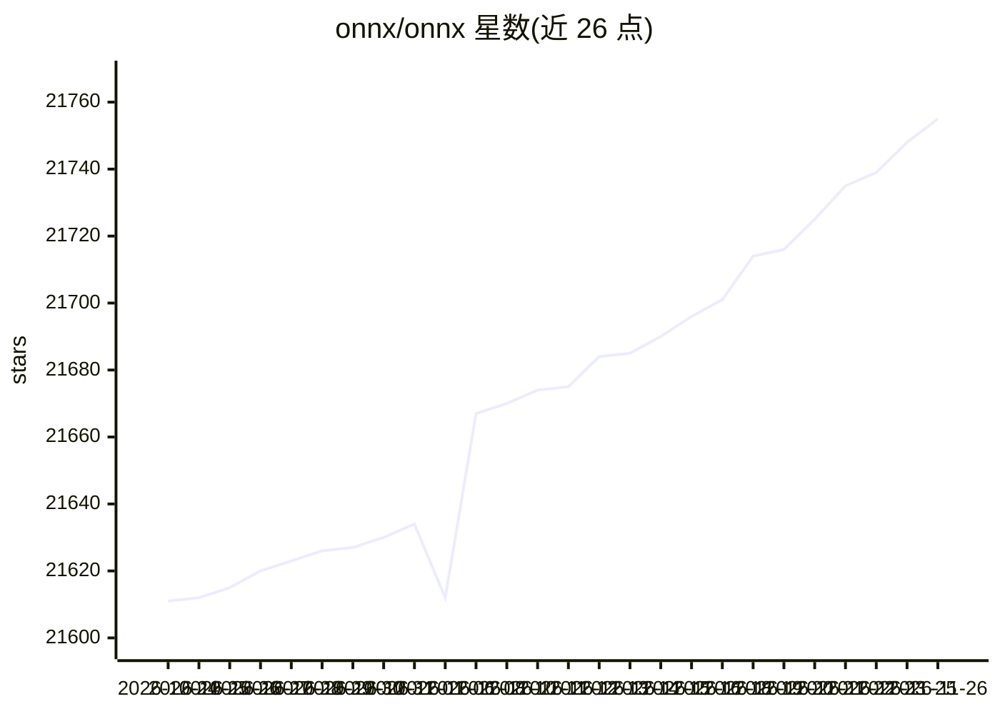

# onnx/onnx

⭐ 21,755 · Python · Apache-2.0 · 推送 2026-11-25 · [GitHub](https://github.com/onnx/onnx) · [官网](https://onnx.ai/) · 组织维护

**面向 AI 开发者的开源模型交换格式与互操作标准库**

ONNX 定义一种开源 AI 模型格式，覆盖深度学习与传统机器学习，包含可扩展计算图模型、内置算子定义与标准数据类型，当前聚焦推理（scoring）所需能力。仓库提供 Python 包（含形状/类型推断、图优化、Opset 版本转换等图处理工具）、中间表示规范文档、预训练模型索引与 Python API，采用社区开放治理并发布于 PyPI，支持 abi3 兼容 wheel 与可复现构建。

## 筛选速览

| 维度 | 判定 | 备注 |
|---|---|---|
| AI 角色 | `ai-ecosystem` | LLM/agent 周边工具 |
| 许可风险 | `permissive` | Apache-2.0 |
| 部署形态 | `library` | 以包/库形式分发 |
| 模型依赖 | — | README 未给出锁定关系 |
| 硬件要求 | — | 无带数字的原话,不猜 |
| 安装摩擦 | `low` | 无编译、无系统依赖或容器化 |
| 成熟度 | — | 结构信号不足 |

## 动量与使用信号

- 维护:`active` — 距上次 push 1.4 天,年发版 7,402 位贡献者
- 涨星:近 1 天 **+2**(自 20261016 起算)
- 安装:pypi 包 `onnx` 月下载 13,120,943

## 能力要点

- 定义可扩展计算图、内置算子与标准数据类型的开源模型格式
- 提供图处理工具：形状/类型推断、图优化、Opset 版本转换
- 发布 PyPI 包，abi3 兼容 wheel 跨多个 Python 版本（3.12 起）
- 构建与发布流程支持 SOURCE_DATE_EPOCH 可复现构建

## 适用场景

- 在不同框架间导出/导入模型实现互操作
- 用 Python API 创建、检查与转换 ONNX 计算图
- 查找预训练 ONNX 模型用于推理部署

## 场景标签

 · 领域:AI 基础设施/模型交换标准

## 证据(README 行号)

> L10: Open Neural Network Exchange (ONNX) is an open ecosystem that empowers AI developers
> L11: to choose the right tools as their project evolves. ONNX provides an open source format for AI models, both deep le
> L31: # Programming utilities for working with ONNX Graphs

## 星数曲线

2026-10-24 21,611 → 2026-11-26 21,755（+144）

---
*卡片 v1 · prompt 1.4 · 生成 2026-11-22 · 置信度 high · 依据 README sha `212d0361fd26` · [字段定义](../../DATASET.md)*
