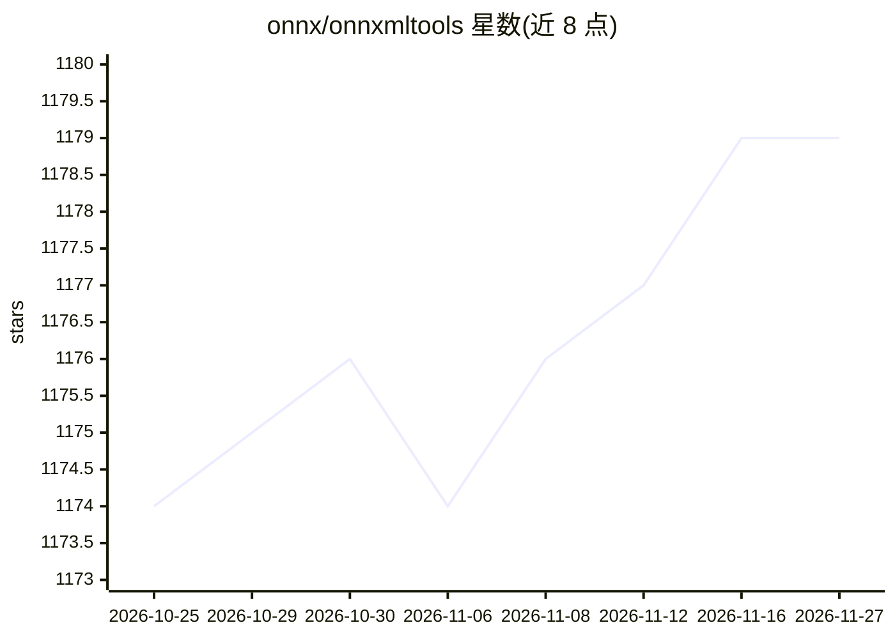

# onnx/onnxmltools

⭐ 1,179 · Python · Apache-2.0 · 推送 2026-11-23 · [GitHub](https://github.com/onnx/onnxmltools) · [官网](https://onnx.ai) · 组织维护

**将多种机器学习工具包模型转换为 ONNX 格式的转换库**

ONNXMLTools 是 onnx 组织下的 Python 库，把 LightGBM、XGBoost、CatBoost、Core ML、H2O MOJO、libsvm、Spark ML 等工具包训练的模型转换为 ONNX 格式，scikit-learn 与 TensorFlow/Keras 分别经由 skl2onnx、tf2onnx 包装支持。每个转换器返回 onnx.ModelProto，可通过 target_opset 控制目标算子集（最高 15）以兼容旧运行时。要求 Python 3.11+、ONNX、NumPy 与 protobuf，转换时需安装产出模型的原始工具包。CI 在 Linux/macOS/Windows 上测试。

## 筛选速览

| 维度 | 判定 | 备注 |
|---|---|---|
| AI 角色 | `ai-ecosystem` | LLM/agent 周边工具 |
| 许可风险 | `permissive` | Apache-2.0 |
| 部署形态 | `library` | 以包/库形式分发 |
| 模型依赖 | — | README 未给出锁定关系 |
| 硬件要求 | — | 无带数字的原话,不猜 |
| 安装摩擦 | `low` | 无编译、无系统依赖或容器化 |
| 成熟度 | — | 结构信号不足 |

## 能力要点

- 支持 LightGBM/XGBoost/CatBoost/Core ML/H2O/libsvm/Spark ML 等 7 类模型转换
- target_opset 参数控制算子集版本（最高 15），保持旧运行时可加载
- 每个转换器返回 onnx.ModelProto 并提供保存工具
- CI 覆盖 Linux/macOS/Windows 与多版本组合矩阵

## 适用场景

- 把已有 XGBoost/LightGBM 模型转为 ONNX 以便跨平台部署
- 将 Core ML 模型迁移为 ONNX 格式
- 为旧版推理运行时生成低 opset 的 ONNX 模型

## 场景标签

`推理引擎` · 领域:训练与推理

## 证据(README 行号)

> L9: ONNXMLTools converts models from machine learning toolkits into ONNX. It supports:
> L18: * scikit-learn, as a wrapper of skl2onnx
> L40: ONNXMLTools requires Python **3.11+**, ONNX, NumPy and protobuf.

## 星数曲线

2026-10-25 1,174 → 2026-11-27 1,179（+5）

---
*卡片 v1 · prompt 1.4 · 生成 2026-11-23 · 置信度 high · 依据 README sha `5163384d9343` · [字段定义](../../DATASET.md)*
