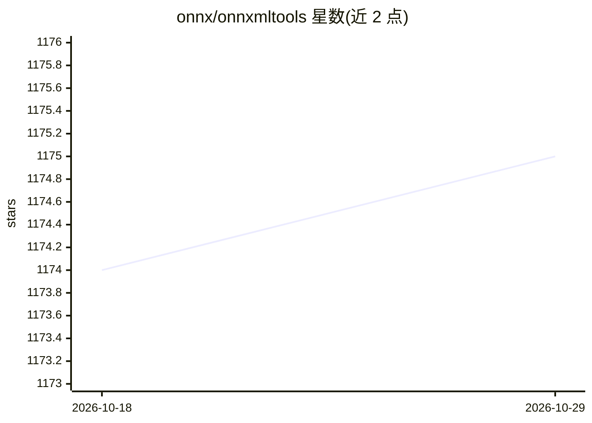

# onnx/onnxmltools

⭐ 1,175 · Python · Apache-2.0 · 推送 2026-10-26 · [GitHub](https://github.com/onnx/onnxmltools) · [官网](https://onnx.ai) · 组织维护

**将各类机器学习框架模型转换为 ONNX 格式的 Python 库**

ONNX 官方生态的模型转换工具：把 TensorFlow、scikit-learn、Core ML、LightGBM、XGBoost、CatBoost、H2O、libsvm、Spark ML（实验性）等框架训练的模型转换为 ONNX 格式，以便在任意 ONNX 后端上计算预测。转换时可通过 target_opset 参数指定目标 ONNX 版本，转换器按算子逐个映射并取各算子最高 opset。以 pip 安装的 Python 库形式提供，依赖 ONNX、NumPy 和 ProtoBuf，源码安装需设置 ONNX_ML=1，兼容 Python 3.9+。

## 筛选速览

| 维度 | 判定 | 备注 |
|---|---|---|
| AI 角色 | `ai-ecosystem` | LLM/agent 周边工具 |
| 许可风险 | `permissive` | Apache-2.0 |
| 部署形态 | `library` | 以包/库形式分发 |
| 模型依赖 | — | README 未给出锁定关系 |
| 硬件要求 | — | 无带数字的原话,不猜 |
| 安装摩擦 | `low` | 无编译、无系统依赖或容器化 |
| 成熟度 | — | 结构信号不足 |

## 能力要点

- 支持 TensorFlow、scikit-learn、Core ML、LightGBM、XGBoost、CatBoost、H2O 等 9 类框架的模型转换
- target_opset 参数控制目标 ONNX 版本，按算子逐个映射取最高 opset
- TensorFlow/scikit-learn 转换分别封装 tf2onnx 与 skl2onnx 转换器

## 适用场景

- 把 scikit-learn 或 LightGBM 模型转为 ONNX 以便跨运行时部署
- 统一多来源模型的交换格式用于推理后端
- 查看转换后模型的 opset 版本并验证兼容性

## 场景标签

 · 领域:机器学习工具链/模型互操作

## 证据(README 行号)

> L9: ONNXMLTools enables you to convert models from different machine learning toolkits into ONNX. Currently the followin
> L94: *onnxmltools* converts models into the ONNX format which

## 星数曲线

2026-10-18 1,174 → 2026-10-29 1,175（+1）

---
*卡片 v1 · prompt 1.4 · 生成 2026-10-21 · 置信度 high · 依据 README sha `783d96da5130` · [字段定义](../../DATASET.md)*
