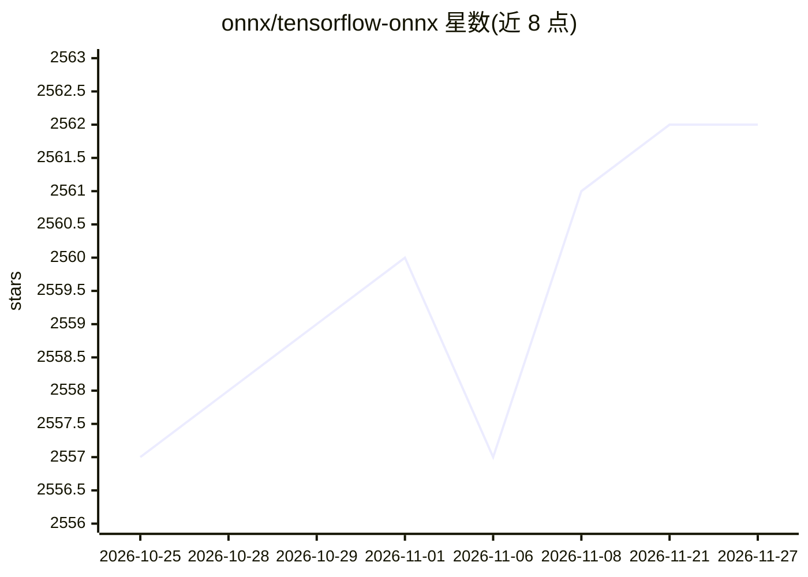

# onnx/tensorflow-onnx

⭐ 2,562 · Jupyter Notebook · Apache-2.0 · 推送 2026-11-26 · [GitHub](https://github.com/onnx/tensorflow-onnx) · 组织维护

**面向开发者的 TensorFlow/Keras/tfjs/tflite 模型转 ONNX 工具**

tf2onnx 通过命令行或 Python API 将 TensorFlow 2.x、Keras、TensorFlow.js（实验性）与 tflite 模型转换为 ONNX 格式。转换流程包括 protobuf 格式转换、类型映射、子图重写、逐 op 处理与图优化，支持 saved-model/checkpoint/graphdef 等输入格式，可指定 opset、自定义 op 映射与大模型外置存储。支持 Python 3.10-3.12 与 tf-2.13+，经 CI 测试的 opset 为 15、18-21。项目当前公开征求新维护者。

## 筛选速览

| 维度 | 判定 | 备注 |
|---|---|---|
| AI 角色 | `ai-ecosystem` | LLM/agent 周边工具 |
| 许可风险 | `permissive` | Apache-2.0 |
| 部署形态 | `library` | 以包/库形式分发 |
| 模型依赖 | — | README 未给出锁定关系 |
| 硬件要求 | — | 无带数字的原话,不猜 |
| 安装摩擦 | `low` | 无编译、无系统依赖或容器化 |
| 成熟度 | — | 结构信号不足 |

## 能力要点

- 支持 CLI（tf2onnx 命令）与 Python API（from_keras/from_function/from_graph_def/from_tflite）两种转换方式
- 支持 saved-model、checkpoint、graphdef、tflite、tfjs 多种输入格式
- 可指定 opset、自定义 op 映射、--large_model 外置张量存储
- 提供预训练模型验证脚本与转换原理文档

## 适用场景

- 把 TensorFlow 训练的模型导出为 ONNX 供其他运行时部署
- 将移动端 tflite 模型转回 ONNX 格式
- Keras 模型需要迁移到 ONNX 生态时做格式转换

## 场景标签

 · 领域:深度学习工具/模型格式转换

## 证据(README 行号)

> L5: tf2onnx converts TensorFlow (tf-2.x), keras, tensorflow.js and tflite models to ONNX via command
> L94: ```python -m tf2onnx.convert --saved-model tensorflow-model-path --output model.onnx```
> L249: The converter needs to take care of a few things:

## 星数曲线



2026-10-25 2,557 → 2026-11-27 2,562（+5）


---
*卡片 v1 · prompt 1.4 · 生成 2026-11-26 · 置信度 high · 依据 README sha `a9cae4416178` · [字段定义](../../DATASET.md)*
