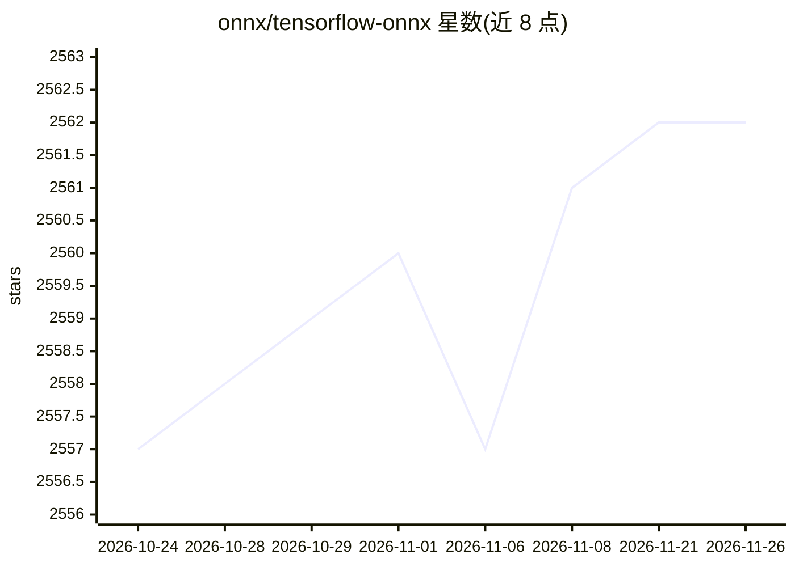

# onnx/tensorflow-onnx

⭐ 2,562 · Jupyter Notebook · Apache-2.0 · 推送 2026-11-25 · [GitHub](https://github.com/onnx/tensorflow-onnx) · 组织维护

**将 TensorFlow/Keras/tfjs/tflite 模型转换为 ONNX 的工具**

tf2onnx 通过命令行或 Python API 将 TensorFlow 2.x、Keras、TensorFlow.js（实验性）与 tflite 模型转换为 ONNX 格式。转换流程包括 protobuf 格式转换、类型映射、子图重写、逐 op 处理、图优化与拓扑排序；支持 saved model、checkpoint、graphdef 等输入格式，可用 --opset 指定目标 opset（默认 15，支持 14-18），并提供 --large_model、--custom-ops 等选项。Python 3.10-3.12、TensorFlow 2.13-2.15，项目目前公开招募新维护者。

## 筛选速览

| 维度 | 判定 | 备注 |
|---|---|---|
| AI 角色 | `ai-ecosystem` | LLM/agent 周边工具 |
| 许可风险 | `permissive` | Apache-2.0 |
| 部署形态 | `library` | 以包/库形式分发 |
| 模型依赖 | — | README 未给出锁定关系 |
| 硬件要求 | — | 无带数字的原话,不猜 |
| 安装摩擦 | `low` | 无编译、无系统依赖或容器化 |
| 成熟度 | — | 结构信号不足 |

## 能力要点

- 支持 saved model/checkpoint/graphdef/tflite 多种输入格式的命令行与 Python API 转换
- 六步转换管线：格式转换、子图重写、逐 op 映射、图优化、拓扑排序
- 支持 ONNX opset 14-18，可用 --opset 指定，含 --large_model 与自定义 op 注册机制
- 附带预训练模型验证脚本 run_pretrained_models.py 与推理计时采集

## 适用场景

- 把 TensorFlow 训练好的模型导出为 ONNX 供其他推理运行时使用
- 将 Keras/tflite 模型迁移到 ONNX 生态
- 为不支持的自定义 op 编写映射扩展转换能力

## 场景标签

 · 领域:深度学习工具/模型互操作

## 证据(README 行号)

> L5: tf2onnx converts TensorFlow (tf-2.x), keras, tensorflow.js and tflite models to ONNX via command
> L92: To get started with `tensorflow-onnx`, run the `tf2onnx.convert` command, providing:

## 星数曲线

2026-10-24 2,557 → 2026-11-26 2,562（+5）

---
*卡片 v1 · prompt 1.4 · 生成 2026-11-24 · 置信度 high · 依据 README sha `66b8a1dda9cc` · [字段定义](../../DATASET.md)*
