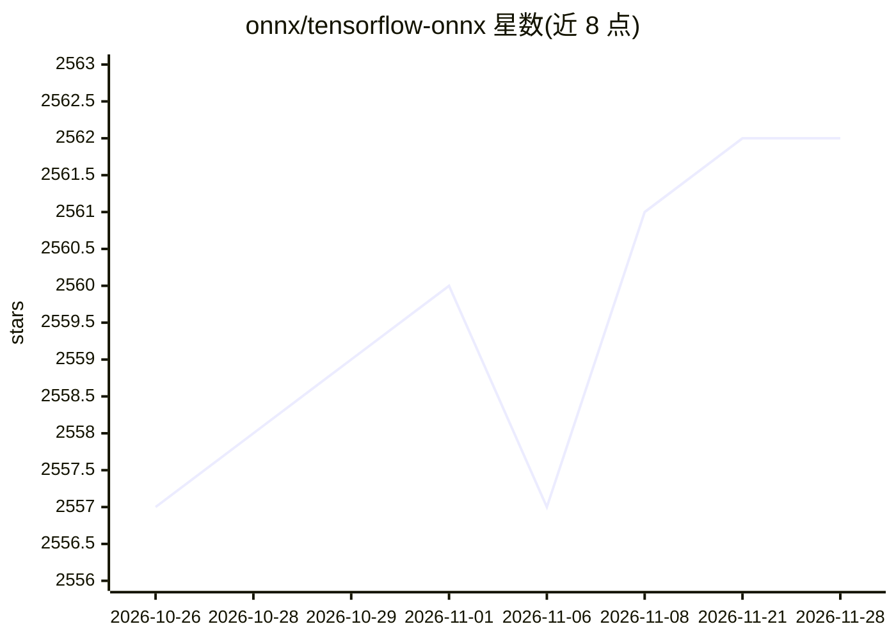

# onnx/tensorflow-onnx

⭐ 2,562 · Jupyter Notebook · Apache-2.0 · 推送 2026-11-27 · [GitHub](https://github.com/onnx/tensorflow-onnx) · 组织维护

**给开发者：将 TensorFlow/Keras/tfjs/tflite 模型转换为 ONNX 格式**

tf2onnx 通过命令行或 Python API 将 tf-2.x、keras、tensorflow.js 与 tflite 模型转换为 ONNX 格式。支持 saved_model、checkpoint、graphdef 等输入格式，可指定目标 opset；转换流程包括 protobuf 格式转换、类型映射、子图重写、逐 op 处理与图优化。支持 Python 3.10-3.12 与 tf-2.13+，tensorflow.js 支持为实验性。提供 CLI 参考、单元测试与预训练模型验证脚本，工具图解转换原理的六个步骤。

## 筛选速览

| 维度 | 判定 | 备注 |
|---|---|---|
| AI 角色 | `ai-ecosystem` | LLM/agent 周边工具 |
| 许可风险 | `permissive` | Apache-2.0 |
| 部署形态 | `library` | 以包/库形式分发 |
| 模型依赖 | — | README 未给出锁定关系 |
| 硬件要求 | — | 无带数字的原话,不猜 |
| 安装摩擦 | `low` | 无编译、无系统依赖或容器化 |
| 成熟度 | — | 结构信号不足 |

## 能力要点

- 命令行与 Python API 双入口（tf2onnx.convert、from_keras/from_function/from_graph_def/from_tflite）
- 支持 saved_model、checkpoint、graphdef、tflite、tfjs 多种输入格式
- 可用 --opset 指定目标 ONNX opset，默认 opset-15
- 提供自定义 op 映射的 Python 接口与预训练模型验证脚本

## 适用场景

- 把 TensorFlow 训练的模型转成 ONNX 以便在其他推理运行时部署
- 将 Keras/tflite 模型迁移到 ONNX 生态
- 在转换后用 run_pretrained_models.py 对比各后端推理结果

## 场景标签

 · 领域:深度学习/模型互操作工具

## 证据(README 行号)

> L5: tf2onnx converts TensorFlow (tf-2.x), keras, tensorflow.js and tflite models to ONNX via command
> L6: line or python api.
> L94: ## Getting started

## 星数曲线

2026-10-26 2,557 → 2026-11-28 2,562（+5）

---
*卡片 v1 · prompt 1.4 · 生成 2026-11-28 · 置信度 high · 依据 README sha `7b9f98e4b409` · [字段定义](../../DATASET.md)*
