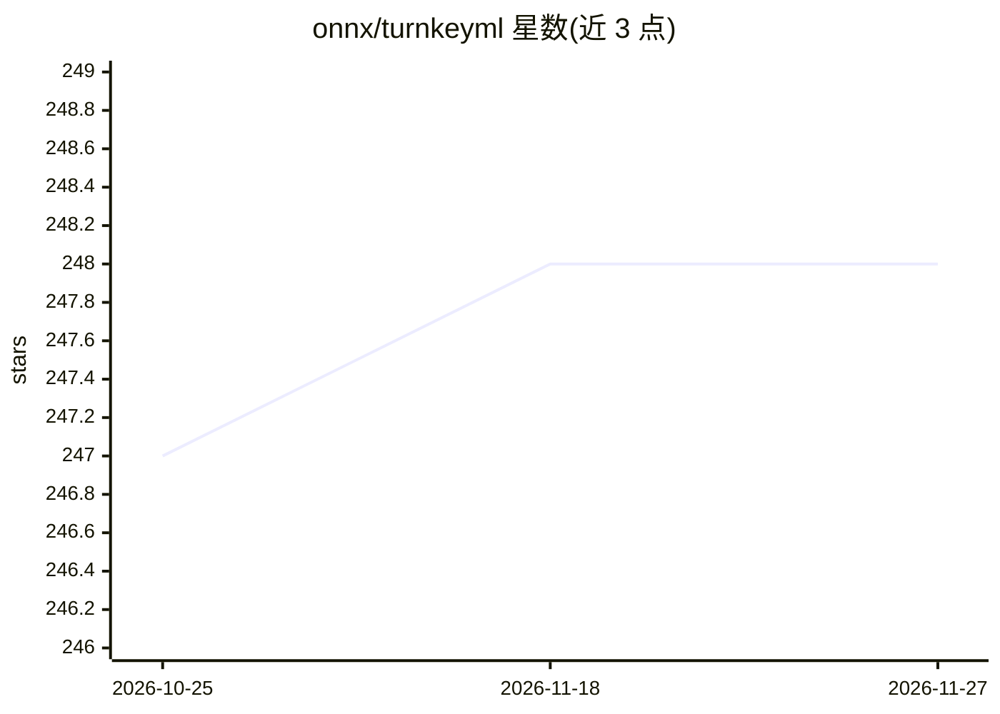

# onnx/turnkeyml

⭐ 248 · Python · Apache-2.0 · 推送 2026-11-23 · [GitHub](https://github.com/onnx/turnkeyml) · 组织维护

**面向 ONNX 工作流的 no-code CLI 工具链**

TurnkeyML 提供无代码 CLI `turnkey`，用于发现 PyTorch 模型、导出为 ONNX，并以可配置序列运行工具链。源码方式安装，要求 Python 3.11，测试覆盖 Windows 与 Linux；支持插件扩展自定义工具与设备，可选模型与 Slurm 依赖。项目由 ONNX Model Zoo SIG 赞助，Lemonade SDK 已拆分至独立仓库需单独安装。

## 筛选速览

| 维度 | 判定 | 备注 |
|---|---|---|
| AI 角色 | `ai-ecosystem` | LLM/agent 周边工具 |
| 许可风险 | `permissive` | Apache-2.0 |
| 部署形态 | `library` | 以包/库形式分发 |
| 模型依赖 | — | README 未给出锁定关系 |
| 硬件要求 | — | 无带数字的原话,不猜 |
| 安装摩擦 | `low` | 无编译、无系统依赖或容器化 |
| 成熟度 | — | 结构信号不足 |

## 能力要点

- no-code CLI 发现 PyTorch 模型并导出 ONNX
- 以可配置序列运行工具链中的工具
- 插件机制扩展自定义工具与设备
- 支持 Slurm 可选依赖

## 适用场景

- 将 PyTorch 模型批量导出为 ONNX 格式
- 为 ONNX 模型组织可配置的工具执行序列
- 通过插件接入自定义工具与设备

## 场景标签

`模型评测` · 领域:评测与运维

## 证据(README 行号)

> L7: TurnkeyML provides a no-code CLI for ONNX workflows. Use `turnkey` to discover
> L8: PyTorch models, export them to ONNX, and run tools in configurable sequences.
> L46: - Plugins: extend Turnkey with custom tools and devices.

## 星数曲线

2026-10-25 247 → 2026-11-27 248（+1）

---
*卡片 v1 · prompt 1.4 · 生成 2026-11-25 · 置信度 mid · 依据 README sha `017bca8a0af4` · [字段定义](../../DATASET.md)*
