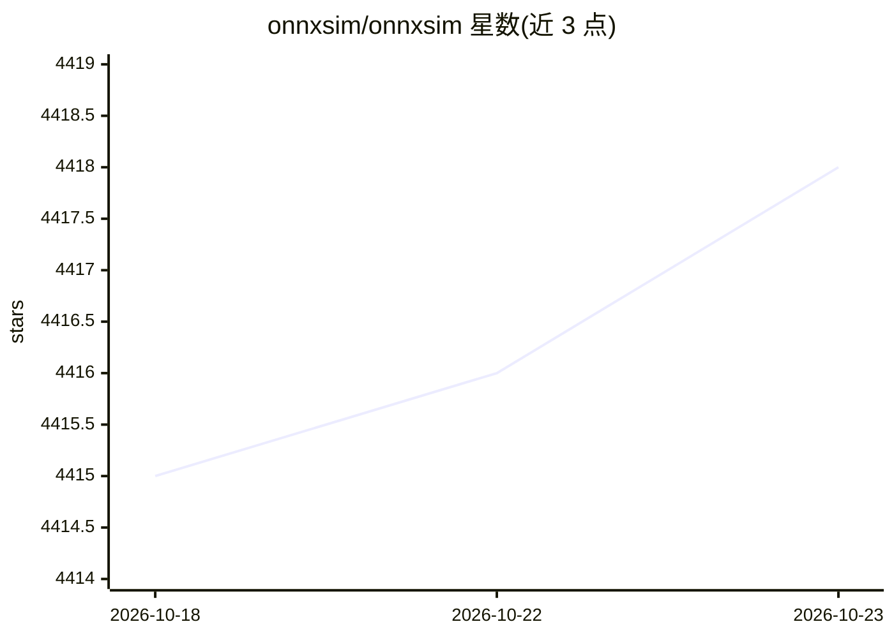

# onnxsim/onnxsim

⭐ 4,418 · Python · Apache-2.0 · 推送 2026-10-19 · [GitHub](https://github.com/onnxsim/onnxsim) · [官网](https://onnxsim.github.io/onnxsim/) · 组织维护

**ONNX 模型简化与导出工具：常量折叠、图优化、多格式转换**

面向深度学习模型部署开发者的 ONNX 计算图处理工具：运行形状推断、图优化与常量折叠的不动点迭代，将冗余算子替换为常量输出，精简导出的 ONNX 模型。支持随机输入等价性校验与基于 z3 的等价性证明、自定义算子保持、opset 升降级，并可导出 MLIR/Core ML/TFLite/Safetensors/GGUF 等格式；提供 transformers、diffusers、Detectron2、SAM 2 等模型的一键导出简化。运行方式覆盖网页版（零安装、本地浏览器执行）、Python 包与 CLI、npm 包、C API 与 Rust 绑定，均共享同一 C++ 核心。onnx 为唯一必需依赖，onnxruntime 等为可选。

## 筛选速览

| 维度 | 判定 | 备注 |
|---|---|---|
| AI 角色 | `ai-ecosystem` | LLM/agent 周边工具 |
| 许可风险 | `permissive` | Apache-2.0 |
| 部署形态 | `library` | 以包/库形式分发 |
| 模型依赖 | — | README 未给出锁定关系 |
| 硬件要求 | — | 无带数字的原话,不猜 |
| 安装摩擦 | `medium` | 含编译或系统依赖之一 |
| 成熟度 | — | 结构信号不足 |

## 能力要点

- 形状推断+图优化+常量折叠的不动点简化流程
- 可选随机输入等价性校验与 z3 符号等价性证明
- 导出 MLIR / Core ML / TFLite / Safetensors / GGUF 多种格式
- transformers / diffusers / Detectron2 / SAM 2 模型一键导出简化

## 适用场景

- 部署前精简 PyTorch 导出的 ONNX 模型，消除冗余算子
- 将 Hugging Face 或扩散模型导出为简化后的 ONNX 部署目录
- 把简化后的模型转换为 Core ML / TFLite 等目标格式
- 校验简化前后模型输出的数值一致性

## 场景标签

 · 领域:深度学习工具链/模型部署

## 证据(README 行号)

> L31: ONNX Simplifier is presented to simplify the ONNX model. It infers the whole computation graph
> L133: - **Many ways to run it.** A zero-install web version, a Python

## 星数曲线

2026-10-18 4,415 → 2026-10-23 4,418（+3）

---
*卡片 v1 · prompt 1.4 · 生成 2026-10-21 · 置信度 high · 依据 README sha `c02ea597ebd2` · [字段定义](../../DATASET.md)*
