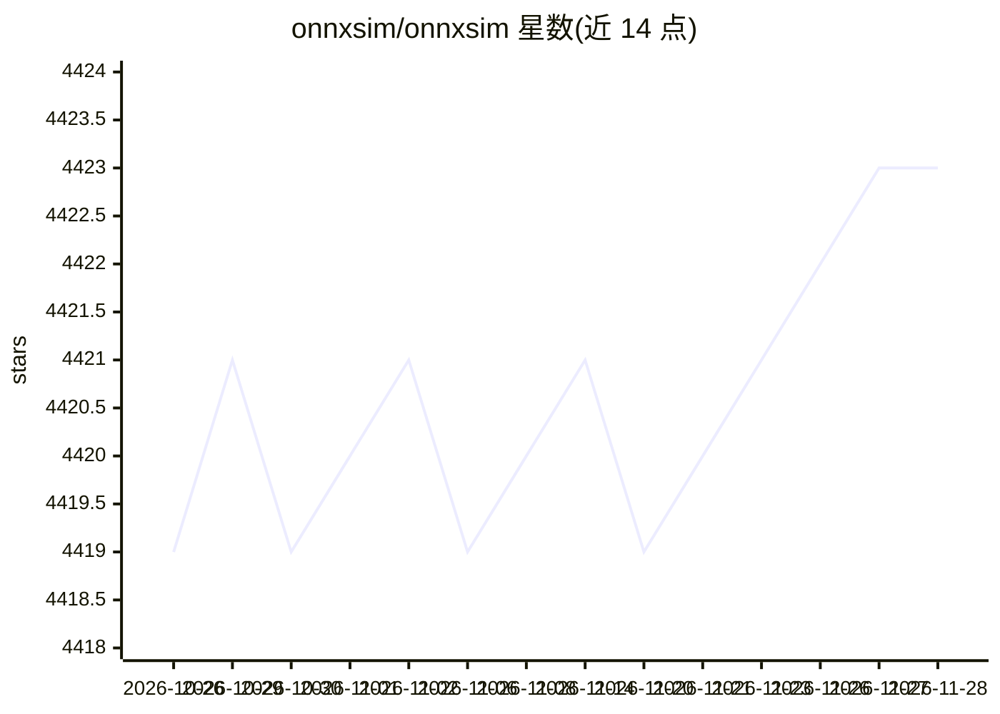

# onnxsim/onnxsim

⭐ 4,423 · Python · Apache-2.0 · 推送 2026-11-27 · [GitHub](https://github.com/onnxsim/onnxsim) · [官网](https://onnxsim.github.io/onnxsim/) · 个人维护

**简化 ONNX 模型的工具：常量折叠与图优化**

ONNX Simplifier 对 ONNX 模型执行形状推理、图优化与常量折叠的定点迭代，用常量输出替换冗余算子。提供 CLI、Python 包、C API、Rust 封装、npm 包及浏览器本地运行的 Web 版，均共享同一 C++ 核心。支持自定义算子保留、opset 转换、函数内联、子图简化，可从 transformers/diffusers/Detectron2/SAM 2 导出，并可转出 Core ML、TFLite、MLIR、safetensors/GGUF 格式。onnx 为唯一必需依赖，其余均为可选。

## 筛选速览

| 维度 | 判定 | 备注 |
|---|---|---|
| AI 角色 | `ai-ecosystem` | LLM/agent 周边工具 |
| 许可风险 | `permissive` | Apache-2.0 |
| 部署形态 | `library` | 以包/库形式分发 |
| 模型依赖 | local-ok | 支持本地模型 |
| 硬件要求 | — | 无带数字的原话,不猜 |
| 安装摩擦 | `medium` | 含编译或系统依赖之一 |
| 成熟度 | — | 结构信号不足 |

## 能力要点

- 常量折叠 + 形状推理 + 图优化的定点迭代简化流程
- 多种形态分发：CLI、Python 包、C API、Rust 封装、npm、零安装 Web 版
- 支持 transformers/diffusers/Detectron2/SAM 2 直接导出为简化 ONNX
- 可选输出 Core ML、TFLite、MLIR、safetensors/GGUF 等格式

## 适用场景

- 导出 PyTorch 模型到 ONNX 后做部署前的图简化
- 把动态输入形状固定为静态形状以便部署
- 将简化后的模型转换为 TFLite 或 Core ML 格式
- 对量化模型做块级微调恢复精度

## 场景标签

 · 领域:深度学习/模型部署工具链

## 证据(README 行号)

> L31: ONNX Simplifier is presented to simplify the ONNX model. It infers the whole computation graph
> L133: - **Many ways to run it.** A zero-install web version, a Python
> L134:  package and `onnxsim` CLI, a C API, and a Rust wrapper — all sharing the same

## 星数曲线

2026-10-26 4,419 → 2026-11-28 4,423（+4）

---
*卡片 v1 · prompt 1.4 · 生成 2026-11-24 · 置信度 high · 依据 README sha `14ac4f2131f8` · [字段定义](../../DATASET.md)*
