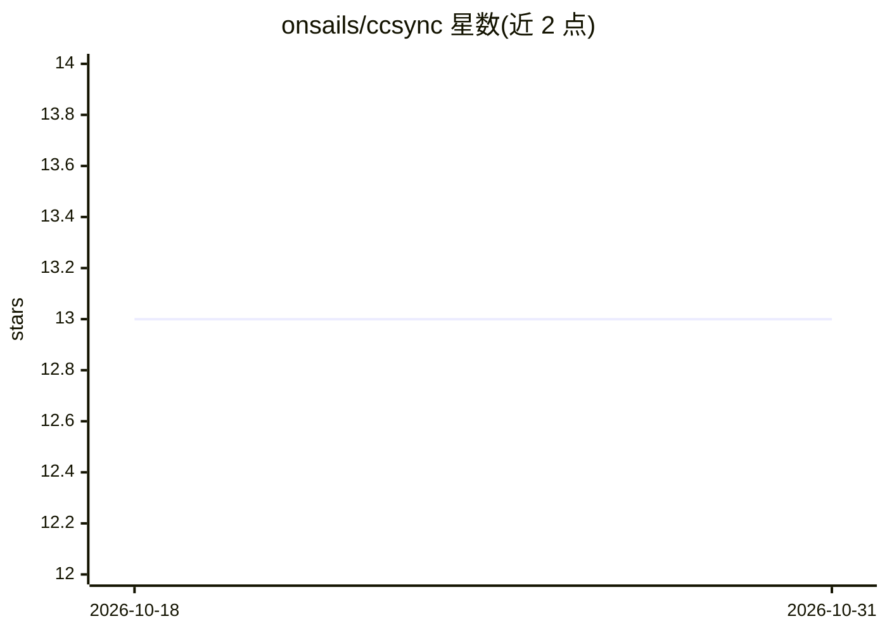

# onsails/ccsync

⭐ 13 · Rust · MIT · 推送 2026-02-12 · [GitHub](https://github.com/onsails/ccsync) · 个人维护

**在全局与项目间双向同步 Claude Code 配置的 CLI 工具**

Rust 编写的命令行工具，用于在 ~/.claude（全局）与项目目录 ./.claude 之间双向同步 Claude Code 的 agents、skills、commands 文件。提供 to-local 与 to-global 两个方向命令，默认逐文件交互式确认（y/n/a/s/d/q），支持 --yes-all 脚本化、--dry-run 预览、--type 按类型过滤、冲突策略（默认询问或 newer 取较新）以及 .ccsync.toml 配置文件（ignore 模式、多级优先级）。通过 cargo 或 curl 脚本安装，Nix 包待合并。面向管理多项目 Claude Code 配置的开发者。

## 筛选速览

| 维度 | 判定 | 备注 |
|---|---|---|
| AI 角色 | `ai-ecosystem` | LLM/agent 周边工具 |
| 许可风险 | `permissive` | MIT |
| 部署形态 | `library` | 以包/库形式分发 |
| 模型依赖 | — | README 未给出锁定关系 |
| 硬件要求 | — | 无带数字的原话,不猜 |
| 安装摩擦 | `low` | 无编译、无系统依赖或容器化 |
| 成熟度 | — | 结构信号不足 |

## 能力要点

- to-local / to-global 双向同步 agents、skills、commands
- 逐文件交互确认与 --dry-run / --yes-all 模式
- 冲突策略可配置（默认询问或 --conflict=newer）
- .ccsync.toml 多级配置（项目/本地/全局），CLI 标志优先

## 适用场景

- 把全局积累的 agents/skills 同步进新项目
- 把项目内定制的命令回收到全局配置复用
- 脚本中自动同步，避免逐个文件手工拷贝

## 场景标签

 · 领域:开发者工具/配置管理

## 证据(README 行号)

> L3: Sync your Claude Code agents, skills, and commands between global and project configurations.
> L104: - **Agents** in `~/.claude/agents/` ↔ `./.claude/agents/`

## 星数曲线

2026-10-18 13 → 2026-10-31 13（+0）

---
*卡片 v1 · prompt 1.4 · 生成 2026-10-31 · 置信度 high · 依据 README sha `0ccec9484503` · [字段定义](../../DATASET.md)*
