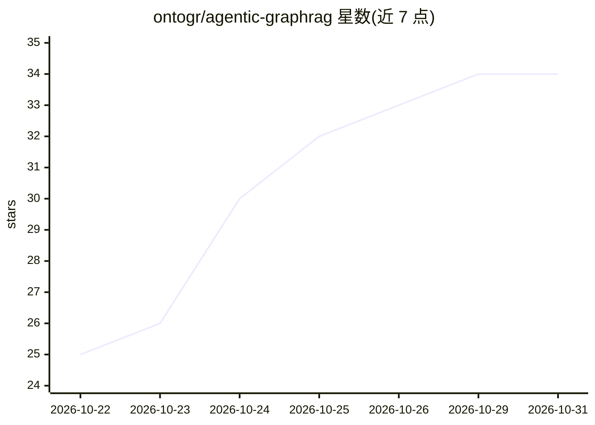

# ontogr/agentic-graphrag

⭐ 34 · Python · Apache-2.0 · 推送 2026-10-27 · [GitHub](https://github.com/ontogr/agentic-graphrag) · [官网](https://ontogr.github.io/agentic-graphrag/) · 组织维护

**Python 框架：把企业文档、agent 历史与决策轨迹接入一张图谱**

开源 Python 框架，将文档（含段落、实体、关系）、agent 会话历史（任务/事件/步骤）与决策轨迹（结论、依据、支持引用）存储于同一张图中，图后端可选 Neo4j 或 FalkorDB，向量可改存 Weaviate 或 Qdrant。抽取先用本地模型、不确定块才交 LLM，可按用户自定义 schema 建图并做实体消歧。提供全文/语义/混合检索、引用校验、跨会话任务恢复、源变更触发决策复审，内置 agent 亦可经 MCP 接入外部 agent，支持 OpenTelemetry 追踪与评测工具。模型可选 Anthropic/OpenAI/Google 或 OpenAI 兼容端点。面向构建企业级 GraphRAG 与可溯源 agent 应用的开发者。

## 筛选速览

| 维度 | 判定 | 备注 |
|---|---|---|
| AI 角色 | `ai-ecosystem` | LLM/agent 周边工具 |
| 许可风险 | `permissive` | Apache-2.0 |
| 部署形态 | `library` | 以包/库形式分发 |
| 模型依赖 | — | README 未给出锁定关系 |
| 硬件要求 | — | 无带数字的原话,不猜 |
| 安装摩擦 | `low` | 无编译、无系统依赖或容器化 |
| 成熟度 | — | 结构信号不足 |

## 能力要点

- 知识/会话历史/决策轨迹三层同图的溯源结构，决策链接到文档段落与事件
- 抽取以本地模型优先，LLM 仅处理不确定块，可无 LLM 建图
- 全文/语义/混合检索（RRF 融合），引用编号且逐条校验版本与权限
- 内置 agent 与本地 MCP server，源变更自动标记受影响决策待复审

## 适用场景

- 企业文档问答中保留每条结论的证据链与版本出处
- agent 跨会话恢复任务并复审因源文档变更而失效的决策
- 用自有 schema（如合同、人员、产品）构建可检索的知识图谱
- 通过 MCP 让自有 agent 复用同一套检索与记录工具

## 场景标签

`RAG` `知识图谱` `Agent 记忆` · 领域:Agent 开发

## 证据(README 行号)

> L17: Agentic GraphRAG is an open source Python framework that connects enterprise knowledge, conversation history, and d
> L27: Use Neo4j or FalkorDB for the graph, embeddings, full-text indexes, and vector indexes. Both support document inges

## 星数曲线

2026-10-22 25 → 2026-10-31 34（+9）

---
*卡片 v1 · prompt 1.4 · 生成 2026-10-25 · 置信度 high · 依据 README sha `69befd5041f8` · [字段定义](../../DATASET.md)*
