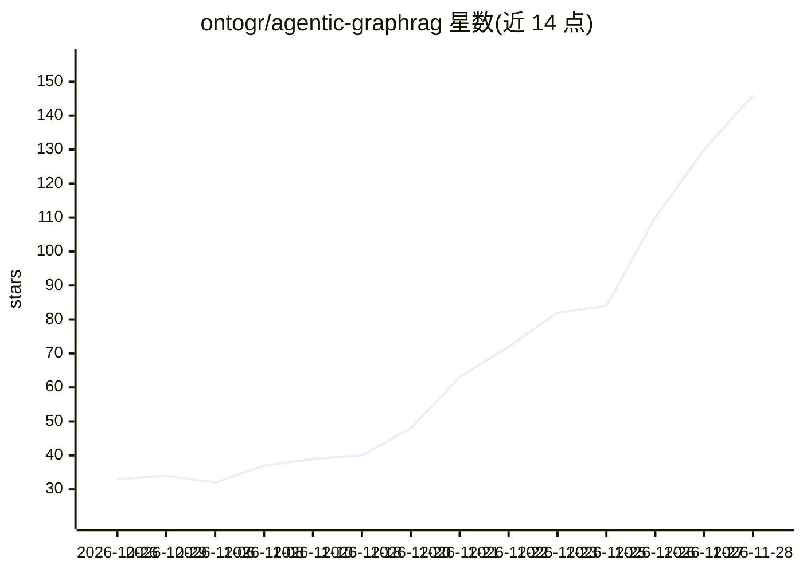

# ontogr/agentic-graphrag

⭐ 146 · Python · Apache-2.0 · 推送 2026-11-24 · [GitHub](https://github.com/ontogr/agentic-graphrag) · [官网](https://ontogr.github.io/agentic-graphrag/) · 组织维护

**把企业知识、对话历史与决策轨迹连成一张图，供 agent 引用与续作**

一个 Python 框架：按用户本体（OWL/RDFS/YAML/Pydantic 等）构建文档图谱，用 Docling 解析文档层级、GLiNER 本地抽取实体与关系，LLM 仅在混合模式低置信度时经 BAML 介入并受 schema 约束。三层图结构连接企业知识、任务事件与决策；决策链接其依据段落，源文档更新时决策标记复审。任务状态存于图中，可跨进程续跑未完成步骤。运行于 Neo4j 或 FalkorDB，向量可存图内或 Qdrant/Milvus/Weaviate，agent 可经 MCP 接入。

## 筛选速览

| 维度 | 判定 | 备注 |
|---|---|---|
| AI 角色 | `ai-ecosystem` | LLM/agent 周边工具 |
| 许可风险 | `permissive` | Apache-2.0 |
| 部署形态 | `self-host` | docker 或自建部署 |
| 模型依赖 | — | README 未给出锁定关系 |
| 硬件要求 | — | 无带数字的原话,不猜 |
| 安装摩擦 | `low` | 无编译、无系统依赖或容器化 |
| 成熟度 | — | 结构信号不足 |

## 能力要点

- 本体驱动的 schema 约束抽取与候选审核，越界结果转为候选并生成 schema 补丁
- GLiNER 本地抽取无 API 调用，混合模式按预算选择性调用 LLM
- 分层实体消解：同标签/精确合并，其余以链接保存，可预览与撤销
- 引用校验比对已读证据 id，未读来源的引用会被标记

## 适用场景

- 让 agent 跨会话恢复任务并只重跑未完成步骤
- 决策引用的源文档改版后自动标记复审
- 按行业本体（如金融 FIBO）构建可引用的知识图谱
- 限制 agent 只在允许的文档范围内检索并核验引用

## 场景标签

`知识图谱` `RAG` · 领域:知识与检索

## 证据(README 行号)

> L17: Agentic GraphRAG is an open source framework that builds one graph connecting your enterprise knowledge to the conv
> L22: - **Fits your stack:** Use it from Python, run the built-in agent, or connect your own agent through MCP. It runs o
> L51: - **Agents:** The built-in agent and any MCP client use the same labels and relation types, and every entity they g

## 星数曲线

2026-10-26 33 → 2026-11-28 146（+113）

---
*卡片 v1 · prompt 1.4 · 生成 2026-11-28 · 置信度 mid · 依据 README sha `ac445e3d6e59` · [字段定义](../../DATASET.md)*
