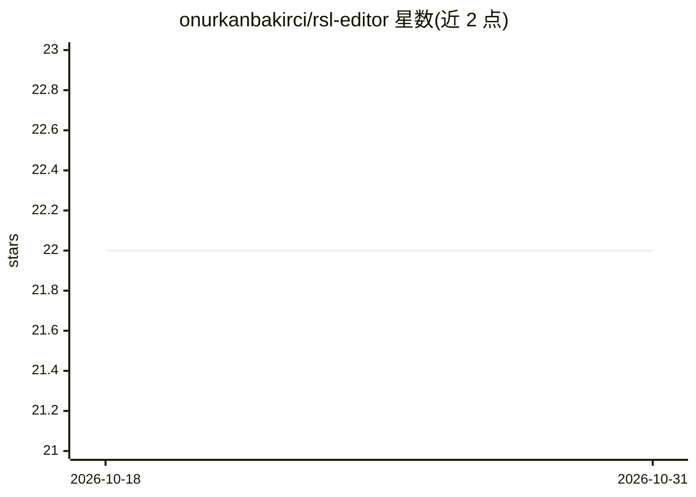

# onurkanbakirci/rsl-editor

⭐ 22 · TypeScript · MIT · 推送 2026-02-16 · [GitHub](https://github.com/onurkanbakirci/rsl-editor) · [官网](https://rsl-editor.onurkanbakirci.com) · 个人维护

**创建和管理 RSL 内容许可文档的开源网页编辑器**

开源 Web 应用，用于创建、验证和管理 Really Simple Licensing（RSL）文档——一种面向 AI 时代的机器可读内容许可格式。提供可视化表单编辑器、文档集中管理面板、内置校验器（错误检查与最佳实践警告）、网站爬取与站点地图解析（用于分析页面并生成 RSL）、RSL XML 生成、RSS 与网页嵌入集成、多许可类型配置（商业/非商业/AI 训练）及批处理操作。面向内容创作者与出版者，需注册账号使用，MIT 许可，2025 年由个人作者创建。

## 筛选速览

| 维度 | 判定 | 备注 |
|---|---|---|
| AI 角色 | `ai-enhanced` | 去掉 AI 部分产品仍成立 |
| 许可风险 | `permissive` | MIT |
| 部署形态 | `None` |  |
| 模型依赖 | — | README 未给出锁定关系 |
| 硬件要求 | — | 无带数字的原话,不猜 |
| 安装摩擦 | `low` | 无编译、无系统依赖或容器化 |
| 成熟度 | — | 结构信号不足 |

## 能力要点

- 可视化表单式 RSL 文档构建与实时配置
- 内置校验器：错误检查与最佳实践警告
- 网站爬取与 XML 站点地图解析，自动分析页面生成 RSL
- 生成机器可读 RSL XML，支持 RSS/网页/媒体文件嵌入许可数据

## 适用场景

- 我为自己的网站内容生成机器可读的 AI 时代许可声明
- 我批量分析网站页面并生成 RSL 许可文档
- 我校验已有 RSL 文档的格式与最佳实践

## 场景标签

 · 领域:内容许可/网页工具

## 证据(README 行号)

> L24: **RSL Editor** is an open-source web application for creating and managing **Really Simple Licensing (RSL)** - a st
> L26: RSL provides a clear, consistent way to define content usage rights, permissions, and restrictions, making it easy 

## 星数曲线

2026-10-18 22 → 2026-10-31 22（+0）

---
*卡片 v1 · prompt 1.4 · 生成 2026-10-27 · 置信度 high · 依据 README sha `1950f50ee53c` · [字段定义](../../DATASET.md)*
