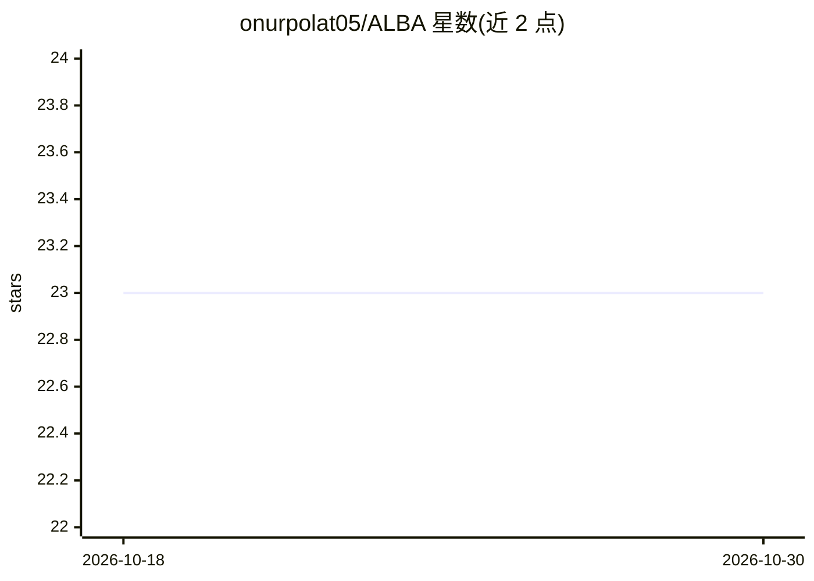

# onurpolat05/ALBA

⭐ 23 · Shell · MIT · 推送 2026-07-27 · [GitHub](https://github.com/onurpolat05/ALBA) · 个人维护

**把 Claude Code 变成带持久记忆的个人 AI agent 模板**

面向 Claude Code 用户的个人 agent 配置模板：通过 10 分钟交互式 /setup（回答 7 个问题）生成带三层文件式持久记忆（HOT/WARM/COLD/LOGS）、9 个技能与 8 个钩子的 agent 目录，支持开发者、PM、研究者、创始人等多种角色。全部由 bash 脚本与 markdown 文件组成，无构建步骤。要求 Claude Code v2.1.218 及以上、Git 与 jq；钩子为 bash 脚本，Windows 经 Git Bash 运行。

## 筛选速览

| 维度 | 判定 | 备注 |
|---|---|---|
| AI 角色 | `ai-ecosystem` | LLM/agent 周边工具 |
| 许可风险 | `permissive` | MIT |
| 部署形态 | `None` |  |
| 模型依赖 | locked-api |  |
| 硬件要求 | — | 无带数字的原话,不猜 |
| 安装摩擦 | `low` | 无编译、无系统依赖或容器化 |
| 成熟度 | — | 结构信号不足 |

## 能力要点

- 三层文件式持久记忆，跨会话保存优先级与进展
- 9 个内置技能（/start /end /research /reflect 等）
- 8 个自动化钩子（危险命令拦截、错误记录等）
- 无包管理器、无构建步骤，纯 bash + markdown

## 适用场景

- 让 Claude Code 记住每天的优先级与项目上下文
- 按自身角色定制个人 AI 助手工作流
- 自动记录错误与经验，跨会话复用

## 场景标签

`AI 助手` `Agent 记忆` · 领域:Agent 开发

## 证据(README 行号)

> L10: ALBA transforms Claude Code into a **personal AI agent** that remembers your priorities, learns from your mistakes,
> L27: Answer 7 questions. ALBA builds a personalized agent system with persistent memory, automated workflows, and self-i
> L191: Hooks are bash scripts triggered by Claude Code events, wired in `.claude/settings.json`. They run automatically —

## 星数曲线

2026-10-18 23 → 2026-10-30 23（+0）

---
*卡片 v1 · prompt 1.4 · 生成 2026-10-27 · 置信度 high · 依据 README sha `2c35a6d35167` · [字段定义](../../DATASET.md)*
