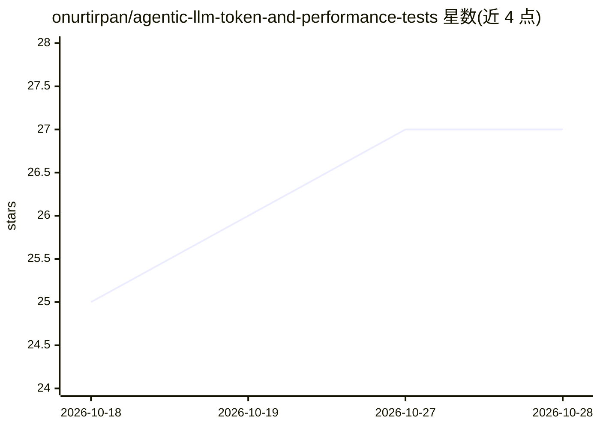

# onurtirpan/agentic-llm-token-and-performance-tests

⭐ 27 · Python · MIT · 推送 2026-08-24 · [GitHub](https://github.com/onurtirpan/agentic-llm-token-and-performance-tests) · [官网](https://onurtirpan.github.io/agentic-llm-token-and-performance-tests/) · 个人维护

**面向 LLM 编码代理的 10 语言×3 规模 HTTP API 基准测试集**

用 10 种语言在 3 个规模档（7/16/34 路由）实现同一 HTTP 服务共 30 份代码，先通过真实 HTTP 上的完整一致性套件与结构化日志校验，再用 tiktoken（o200k_base 与 cl100k_base 双编码器）测量源码 token 成本，并实测冷启动、延迟、吞吐、CPU 与内存。面向需要评估 LLM 代理上下文成本与运行时开销的开发者/团队。结果以 GitHub Pages 上的自包含 HTML 页面与 JSON 数据文件提供；tokenizer 是代理指标，README 建议引用比值而非绝对值，并明示 p99/吞吐排序等数据局限。

## 筛选速览

| 维度 | 判定 | 备注 |
|---|---|---|
| AI 角色 | `ai-ecosystem` | LLM/agent 周边工具 |
| 许可风险 | `permissive` | MIT |
| 部署形态 | `None` |  |
| 模型依赖 | — | README 未给出锁定关系 |
| 硬件要求 | — | 无带数字的原话,不猜 |
| 安装摩擦 | `high` | 编译与系统依赖俱全 |
| 成熟度 | — | 结构信号不足 |

## 能力要点

- 30 份实现先过一致性套件（22/98/139 用例）再测量，30/30 通过
- token 成本用双 tiktoken 编码器交叉验证，排序一致
- 运行时指标覆盖冷启动/延迟/吞吐/CPU/内存，PHP 为三次运行中位数
- 三处公平性修正（OPcache、去框架、keep-alive）公开修正前后数据

## 适用场景

- 评估不同语言后端对 LLM 编码代理的源码上下文成本
- 为后端技术选型对比 token、延迟、内存等实测数据
- 引用比值数据讨论低级语言在真实规模下的成本曲线

## 场景标签

`模型评测` · 领域:评测与运维

## 证据(README 行号)

> L12: The question behind the name: if an LLM coding agent has to read and re-read a
> L16: The same HTTP service, implemented **30 times**: ten languages at three sizes.
> L182: Current state: **30/30 implementations pass — 22, 98 and 139 cases — and every

## 星数曲线

2026-10-18 25 → 2026-10-28 27（+2）

---
*卡片 v1 · prompt 1.4 · 生成 2026-10-26 · 置信度 high · 依据 README sha `5ed2010de3a0` · [字段定义](../../DATASET.md)*
