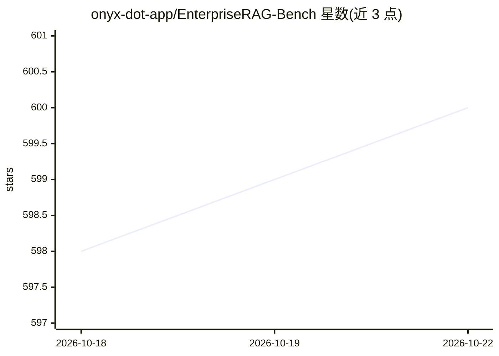

# onyx-dot-app/EnterpriseRAG-Bench

⭐ 600 · MIT · 推送 2026-09-03 · [GitHub](https://github.com/onyx-dot-app/EnterpriseRAG-Bench) · [官网](https://www.onyx.app/) · 组织维护

**企业内部文档 RAG 基准：50 万文档 + 500 题数据集**

面向企业内部知识场景的 RAG 评测数据集与基准：模拟名为 Redwood Inference 的公司，包含约 50 万份文档，来源覆盖 Slack、Gmail、Linear、Google Drive、Hubspot、Fireflies、GitHub、Jira、Confluence 九类；附 500 道分 10 类的问题（含冲突信息、完整性、信息缺失等）及 100 道元数据类附加题。附答案评测代码、排行榜与可生成不同行业/规模类似数据集的框架。数据集从 release 或 HuggingFace 下载。Onyx 自身因有 RAG 产品不参与排行榜。

## 筛选速览

| 维度 | 判定 | 备注 |
|---|---|---|
| AI 角色 | `ai-knowledge` | 知识聚合/清单类 |
| 许可风险 | `permissive` | MIT |
| 部署形态 | `None` |  |
| 模型依赖 | — | README 未给出锁定关系 |
| 硬件要求 | — | 无带数字的原话,不猜 |
| 安装摩擦 | `low` | 无编译、无系统依赖或容器化 |
| 成熟度 | — | 结构信号不足 |

## 能力要点

- 约 50 万文档、9 类企业数据源、500 道分 10 类问题
- 另含 100 道元数据感知 RAG 附加题（extra_questions.jsonl）
- 提供针对不同行业/公司规模生成同类数据集的代码
- 附排行榜，提交需满足可复现性要求（开源复现指南或沙箱端点）

## 适用场景

- 评测自家 RAG 系统在企业内部数据上的检索与回答能力
- 在内部文档类数据上微调 agent
- 生成适配自身行业与规模的合成企业数据集

## 场景标签

`模型评测` · 领域:评测与运维

## 证据(README 行号)

> L11: EnterpriseRAG Bench provides a dataset for company internal documents consisting of slightly over **500,000 documen
> L12: We release this dataset to help teams benchmark their RAG systems and fine-tune agents on realistic enterprise data

## 星数曲线

2026-10-18 598 → 2026-10-22 600（+2）

---
*卡片 v1 · prompt 1.4 · 生成 2026-10-21 · 置信度 high · 依据 README sha `4f737286ba5b` · [字段定义](../../DATASET.md)*
