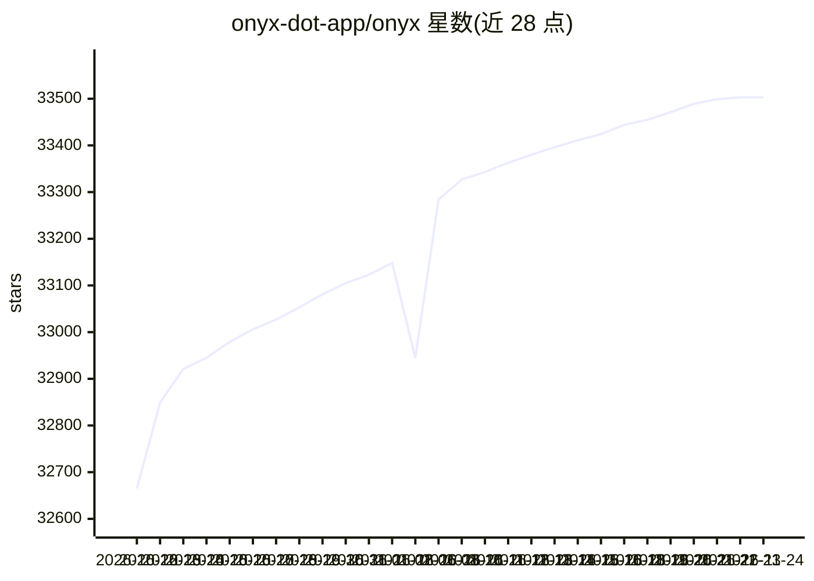

# onyx-dot-app/onyx

⭐ 33,516 · Python · NOASSERTION · 推送 2026-11-24 · [GitHub](https://github.com/onyx-dot-app/onyx) · [官网](https://onyx.app) · 组织维护

**企业团队知识层平台：AI 问答 + 50+ 应用知识索引**

面向企业与团队的知识/上下文平台：连接 50+ 应用做索引检索，提供 RAG 问答、深度研究、自定义 Agent、网页搜索、代码沙箱、语音模式等功能；支持自托管与气隙部署，文档索引、数据库与处理均在本环境内运行。Web/桌面端之外提供 Slack/Discord 机器人、MCP server、Chrome 扩展与可嵌入组件入口；支持 Docker/Kubernetes/Helm/Terraform 部署及 Standard/Lite 两种模式，企业功能含 SSO、RBAC、审计与白标。MIT 许可的 CE 版与 EE 商业版并存。

## 筛选速览

| 维度 | 判定 | 备注 |
|---|---|---|
| AI 角色 | `ai-native` | 本体是模型或模型工具 |
| 许可风险 | `none` | NOASSERTION |
| 部署形态 | `None` |  |
| 模型依赖 | local-ok | 支持本地模型 |
| 硬件要求 | — | 无带数字的原话,不猜 |
| 安装摩擦 | `low` | 无编译、无系统依赖或容器化 |
| 成熟度 | — | 结构信号不足 |

## 动量与使用信号

- 维护:`active` — 距上次 push 0.8 天,年发版 100,195 位贡献者
- 涨星:近 1 天 **+34**(自 20261016 起算)
- 平台:— · 协议:MCP / OLLAMA

## 能力要点

- 连接 50+ 应用索引知识，支持自托管与气隙部署
- Agentic RAG、深度研究、自定义 Agent、代码沙箱
- MCP server、Slack/Discord bot、Chrome 扩展多入口接入
- SSO（OIDC/SAML）、RBAC、SCIM 等企业功能

## 适用场景

- 团队内部知识库问答，让 LLM 回答基于公司文档
- 在 Slack/Discord 中通过机器人获取组织知识答案
- 让 AI agent 带权限控制地获取公司上下文并执行任务
- 自托管部署以保持数据主权

## 场景标签

`文档问答` `RAG` `语义搜索` · 领域:知识与检索

## 证据(README 行号)

> L22: **Onyx** is the knowledge/context layer for your team and AI agents.
> L46: - **🔍 Agentic RAG:** Get best in class search and answer quality based on hybrid index + a custom agent harness tun
> L108: - 🔐 Single Sign On: SSO via Google OAuth, OIDC, or SAML. Group syncing and user provisioning via SCIM.

## 星数曲线

2026-10-22 32,665 → 2026-11-24 33,503（+838）

---
*卡片 v1 · prompt 1.4 · 生成 2026-11-22 · 置信度 high · 依据 README sha `cf0a0df503a2` · [字段定义](../../DATASET.md)*
