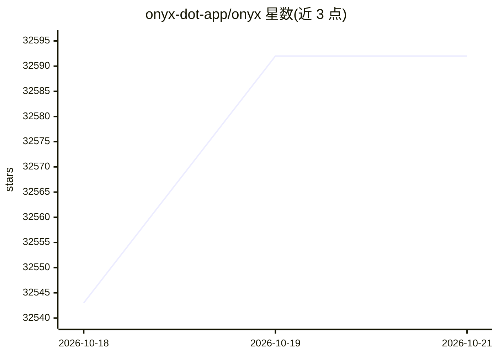

# onyx-dot-app/onyx

⭐ 32,592 · Python · NOASSERTION · 推送 2026-10-19 · [GitHub](https://github.com/onyx-dot-app/onyx) · [官网](https://onyx.app) · 组织维护

**给团队接入内部知识的企业 AI 聊天与 RAG 平台**

Onyx 是面向团队与企业的知识/上下文平台：连接 50+ 应用索引数据（含权限元数据），提供检索增强问答、深度研究、自定义 Agent、联网搜索、沙箱代码执行、语音交互等功能。支持自托管与气隙部署，数据索引与处理在自身环境内完成；提供 Web、桌面端、Slack/Discord 机器人、MCP server、Chrome 扩展与嵌入式组件多种访问方式。采用 CE（MIT）+ EE 双版本模式，标准版与轻量版两种部署形态。

## 筛选速览

| 维度 | 判定 | 备注 |
|---|---|---|
| AI 角色 | `ai-native` | 本体是模型或模型工具 |
| 许可风险 | `dual` | NOASSERTION |
| 部署形态 | `None` |  |
| 模型依赖 | local-ok | 支持本地模型 |
| 硬件要求 | — | 无带数字的原话,不猜 |
| 安装摩擦 | `low` | 无编译、无系统依赖或容器化 |
| 成熟度 | — | 结构信号不足 |

## 动量与使用信号

- 维护:`active` — 距上次 push 0.8 天,年发版 100,195 位贡献者
- 涨星:近 1 天 **+34**(自 20261016 起算)
- 平台:— · 协议:MCP / OLLAMA

## 能力要点

- 连接 50+ 应用构建组织知识索引
- Agentic RAG 与多步深度研究流程
- 支持自托管/气隙部署，模型与嵌入可本地运行
- MCP server 方式向外部 AI 客户端提供组织上下文

## 适用场景

- 给团队搭一个带权限控制的内部知识问答
- 部署在 Slack/Discord 里回答组织相关问题
- 自托管 RAG 平台对接本地或商用 LLM

## 场景标签

`RAG` `聊天机器人` · 领域:对话与助手

## 证据(README 行号)

> L22: **Onyx** is the knowledge/context layer for your team and AI agents.
> L24: Onyx connects to your application to index and surface knowledge from 50+ applications while protecting your data s
> L57: Onyx supports all major LLM providers, both self-hosted (like Ollama, LiteLLM, vLLM, etc.) and proprietary (like An

## 星数曲线

2026-10-18 32,543 → 2026-10-21 32,592（+49）

---
*卡片 v1 · prompt 1.4 · 生成 2026-10-18 · 置信度 high · 依据 README sha `89f5bc7524ca` · [字段定义](../../DATASET.md)*
