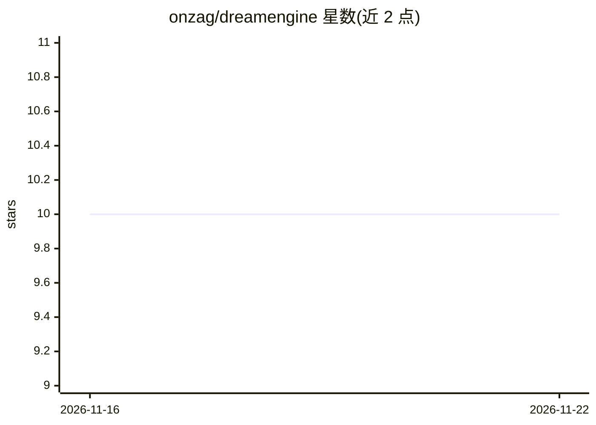

# onzag/dreamengine

⭐ 10 · JavaScript · AGPL-3.0 · 推送 2026-11-21 · [GitHub](https://github.com/onzag/dreamengine) · [官网](https://WildReality.org) · 个人维护

**面向角色扮演玩家与创作者的 LLM 驱动网络模拟引擎**

基于 RStory 原型、以 Electron NodeJS 应用形式实现的 LLM 角色扮演模拟引擎，提供游戏状态编排：物品持久化、角色关系键随行为演化、用户作为普通角色参与、剧情规则约束、角色特质/状态/触发器系统、无全知视角、动态上下文缩放、力量分级与物理体积重量。角色与世界以沙箱 JavaScript 脚本定义，不兼容角色卡。引擎通过 OpenAI 兼容 API 连接本地推理服务器，并依赖 grammar 跟踪世界状态；维护状态需要额外推理开销。

## 筛选速览

| 维度 | 判定 | 备注 |
|---|---|---|
| AI 角色 | `ai-native` | 本体是模型或模型工具 |
| 许可风险 | `viral` | AGPL-3.0 |
| 部署形态 | `None` |  |
| 模型依赖 | local-ok | 支持本地模型 |
| 硬件要求 | — | 无带数字的原话,不猜 |
| 安装摩擦 | `low` | 无编译、无系统依赖或容器化 |
| 成熟度 | `idea` | |

## 能力要点

- 以 LLM 编排游戏状态：物品持久化、角色关系演化、剧情规则强制
- 角色/世界/物品以沙箱 JavaScript 脚本定义，不使用角色卡
- 动态指数缩放上下文，减少重复
- 通过 OpenAI 兼容 API 支持 Llama、Mistral、GLM 等底层模型

## 适用场景

- 构建有持久世界状态的 LLM 角色扮演游戏
- 自定义脚本编写角色特质、状态与触发器行为
- 部署本地推理服务器驱动的多人共享剧情实例

## 场景标签

`聊天机器人` · 领域:对话与助手

## 证据(README 行号)

> L9: DreamEngine is made as a LLM Roleplay Simulation engine, not as a simple method to interact with language models in 
> L11: The name DreamEngine is not merely a name, it is indeed akin a small RPG game engine with lifecycles, that orchesta
> L89: For local servers check out vllm or Llama.cpp and deploy and openAI compatible API server, then point the engine to

## 星数曲线

2026-11-16 10 → 2026-11-22 10（+0）

---
*卡片 v1 · prompt 1.4 · 生成 2026-11-19 · 置信度 high · 依据 README sha `72f0ae636fd2` · [字段定义](../../DATASET.md)*
