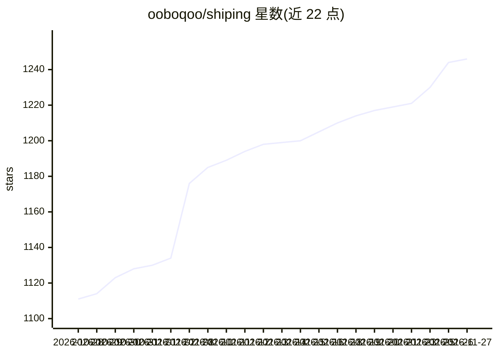

# ooboqoo/shiping

⭐ 1,246 · TypeScript · NOASSERTION · 推送 2026-11-24 · [GitHub](https://github.com/ooboqoo/shiping) · 个人维护 · 中文 README

**截屏+AI 识别屏幕内容的桌面助手：题目/代码/报错/外文即问即答**

基于 Electron 的桌面应用，常驻后台：框选屏幕区域后由视觉模型流式给出解释、翻译或解题代码；另设对话模式，通过百炼 Fun-ASR 实时转录系统音频中的对方语音并生成回答要点。支持自定义场景提示词、本机资料库与 RAGFlow 外部知识库接入、手机浏览器同步控制、隐身窗口（共享屏幕不显示）。用户自备兼容 OpenAI API 的平台与 API Key。提供 Windows/macOS（Apple 芯片）安装包，Intel 芯片需从源码运行；许可为 CC BY-NC 4.0，禁止商用。

## 筛选速览

| 维度 | 判定 | 备注 |
|---|---|---|
| AI 角色 | `ai-native` | 本体是模型或模型工具 |
| 许可风险 | `none` | NOASSERTION |
| 部署形态 | `desktop` | 安装包/桌面程序 |
| 模型依赖 | locked-api |  |
| 硬件要求 | — | 无带数字的原话,不猜 |
| 安装摩擦 | `low` | 无编译、无系统依赖或容器化 |
| 成熟度 | — | 结构信号不足 |

## 能力要点

- 框选识别与截图解题两种模式，支持多轮追加截图与追问
- 对话模式实时转录系统音频并生成回答提示
- 接入自部署 RAGFlow 外部知识库，兼容 Dify 外部知识库 API 格式
- 隐身模式使窗口不出现在屏幕共享与录屏画面

## 适用场景

- 框选看不懂的代码、报错、图表、外文资料获得解释或翻译
- 算法笔试/在线编程题截屏获取思路与完整代码
- 线上面试中实时听对方问题并生成回答要点
- 导入简历笔记作为资料库辅助作答

## 场景标签

`AI 助手` `OCR` `语音识别` · 领域:对话与助手

## 证据(README 行号)

> L3: > 屏幕上的内容，截一下、框一下，AI 就看懂：题目、代码、报错、图表、外文资料，按下快捷键就有解答。平时常驻后台，随叫随到。听对话时，对方说完就有提示。隐身模式可以让窗口不出现在屏幕共享和录屏画面里（是否生效因电脑和软件而异，用前
> L49: |算法笔试 / 在线编程题|截图模式「解算法题」：思路和完整代码，默认用 TypeScript|

## 星数曲线

2026-10-28 1,111 → 2026-11-27 1,246（+135）

---
*卡片 v1 · prompt 1.4 · 生成 2026-11-25 · 置信度 high · 依据 README sha `edc06e60153f` · [字段定义](../../DATASET.md)*
