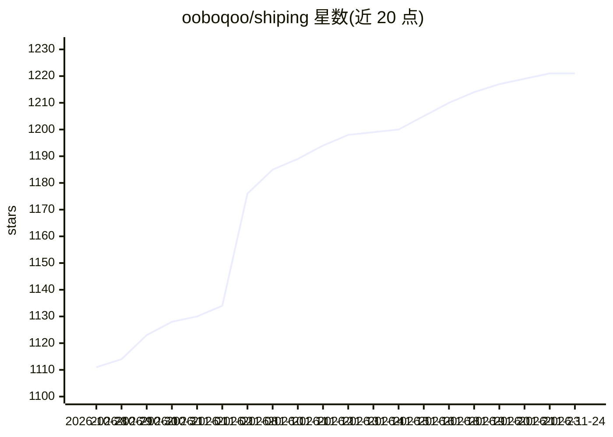

# ooboqoo/shiping

⭐ 1,230 · TypeScript · NOASSERTION · 推送 2026-11-23 · [GitHub](https://github.com/ooboqoo/shiping) · 个人维护 · 中文 README

**给需要看懂屏幕内容的人：截屏+AI 出解答的桌面工具**

Electron 桌面应用，常驻后台，通过快捷键框选或截取屏幕后交视觉模型解答。三种主要模式：框选识别（解释/翻译代码、报错、图表、外文）、截图模式（流式解答题目，支持追加截图与追问）、对话模式（实时转录系统音频中对方的话并生成提示要点）。用户自配 API Base URL 与 Key，支持多套模型配置；含隐身模式（共享屏幕时隐藏窗口）、本机资料库、可接入自部署 RAGFlow 外部知识库、手机同步。提供 Windows 安装包与 macOS（Apple 芯片）安装包，其他可从源码运行。

## 筛选速览

| 维度 | 判定 | 备注 |
|---|---|---|
| AI 角色 | `ai-native` | 本体是模型或模型工具 |
| 许可风险 | `none` | NOASSERTION |
| 部署形态 | `desktop` | 安装包/桌面程序 |
| 模型依赖 | locked-api |  |
| 硬件要求 | — | 无带数字的原话,不猜 |
| 安装摩擦 | `low` | 无编译、无系统依赖或容器化 |
| 成熟度 | `idea` | |

## 能力要点

- 框选/全屏截图 + 视觉模型流式解答，支持追加截图与连续追问
- 对话模式实时识别系统音频并生成回答要点
- 隐身模式使窗口不出现在屏幕共享/录屏中
- 本机资料库与 RAGFlow 外部知识库接入

## 适用场景

- 框选看不懂的代码、报错或外文资料获得解释翻译
- 配置自己的 API Key 处理在线编程题截图
- 线上会议中获取对方发言的要点提示
- 导入简历与笔记作为 AI 作答的参考资料

## 场景标签

`AI 助手` `OCR` · 领域:对话与助手

## 证据(README 行号)

> L3: > 屏幕上的内容，截一下、框一下，AI 就看懂：题目、代码、报错、图表、外文资料，按下快捷键就有解答。平时常驻后台，随叫随到。听对话时，对方说完就有提示。隐身模式可以让窗口不出现在屏幕共享和录屏画面里（是否生效因电脑和软件而异，用前
> L11: 按 `⌥⇧ S`（Windows 为 `Ctrl+Alt+S`）或单击菜单栏（Windows 为通知区域）里的识屏图标，拖出要识别的一块，松开鼠标就有解答；看完按 `Esc`，窗口隐藏，键盘回到原来的应用。看不懂的代码、报错、图表
> L23: 实时识别对方说的话，对方说完一句，右侧就出提示：一句能直接说出口的开场，加几个要点。采集的是系统音频，线上会议里就是对方的声音，自己说话不会触发；也可以按 `⌥ G`（Windows 为 `Ctrl+G`）随时出提示。

## 星数曲线

2026-10-28 1,111 → 2026-11-24 1,221（+110）

---
*卡片 v1 · prompt 1.4 · 生成 2026-11-23 · 置信度 high · 依据 README sha `24f2ed538fbe` · [字段定义](../../DATASET.md)*
