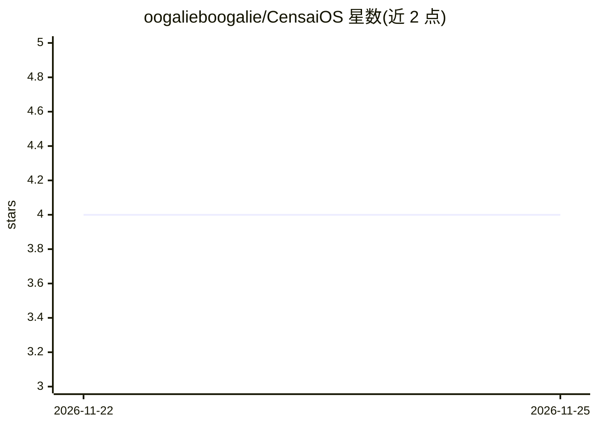

# oogalieboogalie/CensaiOS

⭐ 4 · JavaScript · Apache-2.0 · 推送 2026-11-22 · [GitHub](https://github.com/oogalieboogalie/CensaiOS) · [官网](https://www.censaios.com) · 个人维护

**自托管的多人无限画布，让应用窗口与 AI agent 同板协作**

CensaiOS 是一个自托管的协作画布：聊天、文档、表格、终端、浏览器、3D、音乐等约 70 种窗口类型打开在同一块无限画布上，人与 agent 共处同一工作区，agent 可在被授权后操作窗口、在后台排队运行任务并保持记忆与知识图谱事实。通过 Docker Compose 一键启动，数据存于本地 Docker 卷，API 密钥加密存入内置 PostgreSQL；Qdrant 提供可选的语义召回。支持多人实时协同编辑（Yjs）与多模型并排对比的 arena。Windows 安装包尚未签名，当前以 Docker 为受支持的运行方式。

## 筛选速览

| 维度 | 判定 | 备注 |
|---|---|---|
| AI 角色 | `ai-native` | 本体是模型或模型工具 |
| 许可风险 | `permissive` | Apache-2.0 |
| 部署形态 | `desktop` | 安装包/桌面程序 |
| 模型依赖 | local-ok | 支持本地模型 |
| 硬件要求 | — | 无带数字的原话,不猜 |
| 安装摩擦 | `low` | 无编译、无系统依赖或容器化 |
| 成熟度 | `idea` | |

## 能力要点

- 70+ 窗口类型共处一块多人无限画布，agent 与人同板协作
- agent 支持身份/角色/工具/权限配置、后台任务队列与本地记忆存储
- Ollama 本地免密钥使用，另支持 OpenAI 兼容、OpenRouter、Gemini 等 provider
- 密钥加密存于本地 PostgreSQL，无遥测，Docker 访问经 runner 隔离

## 适用场景

- 团队在同一画布上实时协作并让 agent 代为操作工具窗口
- 在本地/私有服务器自托管一个不外发数据的 AI 工作区
- 并排对比多个 AI 模型的速度、token 与成本
- 把散落的聊天、文档、终端工作统一到空间化看板

## 场景标签

`AI 助手` `知识图谱` · 领域:对话与助手

## 证据(README 行号)

> L3: **One canvas where your apps and your AI agents live together.** Chat, docs, sheets, a browser,
> L179: - Run with Ollama locally or use OpenAI-compatible, OpenRouter, Gemini, and other configured providers.

## 星数曲线

2026-11-22 4 → 2026-11-25 4（+0）

---
*卡片 v1 · prompt 1.4 · 生成 2026-11-22 · 置信度 mid · 依据 README sha `29688d246d38` · [字段定义](../../DATASET.md)*
