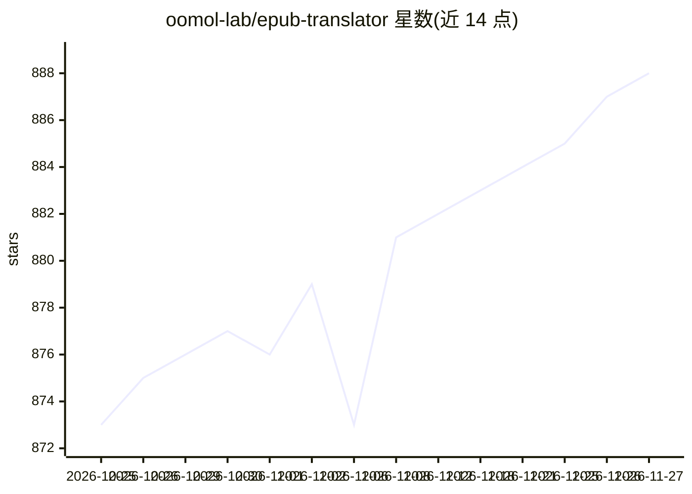

# oomol-lab/epub-translator

⭐ 888 · Python · MIT · 推送 2026-11-23 · [GitHub](https://github.com/oomol-lab/epub-translator) · [官网](https://pdfcraft.ai/epub-translator) · 组织维护 · 中文 README

**用 LLM 将 EPUB 转成保留原文的双语电子书**

Python 库与在线/托管服务，调用 LLM 翻译 EPUB 图书并保留原文，输出单语或双语版本（原文与译文并排/分块显示），保留原书排版、图片与结构。支持自定义提示词、翻译与 XML 填充的双 LLM 分工、失败重试与错误回调、断点续翻缓存、并发翻译及 token 用量统计。安装仅需 pip 与 Python 3.11–3.13，需自备 LLM API endpoint；也可通过 OOMOL Studio 图形界面或托管 API/MCP 使用。

## 筛选速览

| 维度 | 判定 | 备注 |
|---|---|---|
| AI 角色 | `ai-native` | 本体是模型或模型工具 |
| 许可风险 | `permissive` | MIT |
| 部署形态 | `library` | 以包/库形式分发 |
| 模型依赖 | — | README 未给出锁定关系 |
| 硬件要求 | — | 无带数字的原话,不猜 |
| 安装摩擦 | `low` | 无编译、无系统依赖或容器化 |
| 成熟度 | — | 结构信号不足 |

## 能力要点

- 三种提交模式：替换原文/行内双语/分块双语
- 双 LLM 架构：翻译与 XML 填充可用不同模型与参数
- 失败自动重试（默认 5 次）与缓存断点续翻
- 并发翻译与实时 token 用量监控

## 适用场景

- 语言学习者制作原文+译文对照的电子书
- 研究人员对照阅读外文文献
- 将外文小说整体转成双语版本
- 扫描版 PDF 先经 PDF Craft 转 EPUB 再翻译

## 场景标签

`科研工具` · 领域:学习与行业

## 证据(README 行号)

> L14: Want to read a book in a foreign language without losing the original context? EPUB Translator transforms any EPUB 
> L59: from epub_translator import LLM, translate, language, SubmitKind
> L191: ```python

## 星数曲线



2026-10-25 873 → 2026-11-27 888（+15）


---
*卡片 v1 · prompt 1.4 · 生成 2026-11-25 · 置信度 high · 依据 README sha `1e6528452941` · [字段定义](../../DATASET.md)*
