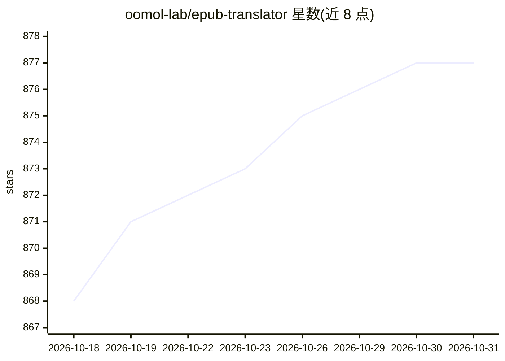

# oomol-lab/epub-translator

⭐ 877 · Python · MIT · 推送 2026-09-18 · [GitHub](https://github.com/oomol-lab/epub-translator) · [官网](https://pdfcraft.ai/epub-translator) · 组织维护 · 中文 README

**用 LLM 把 EPUB 转为原文对照双语书的 Python 库**

Python 库，调用 OpenAI 兼容 API（含 OpenAI 与 Azure OpenAI 配置示例）翻译 EPUB 电子书，输出保留原格式、图片与结构的双语版本。提供 pip 安装与 translate 函数 API，支持三种插入模式（替换/行内追加/块级追加）、双 LLM 架构（翻译与 XML 结构填充分离）、自定义翻译提示、缓存断点续译、并发翻译与 token 用量统计，失败自动重试（默认 5 次）。也可通过 OOMOL Studio 可视化界面或官方在线版使用，需自备 API key。

## 筛选速览

| 维度 | 判定 | 备注 |
|---|---|---|
| AI 角色 | `ai-native` | 本体是模型或模型工具 |
| 许可风险 | `permissive` | MIT |
| 部署形态 | `library` | 以包/库形式分发 |
| 模型依赖 | locked-api |  |
| 硬件要求 | — | 无带数字的原话,不猜 |
| 安装摩擦 | `low` | 无编译、无系统依赖或容器化 |
| 成熟度 | — | 结构信号不足 |

## 能力要点

- 双语对照输出并保留原书格式、图片与结构
- 双 LLM 架构：翻译与 XML 结构填充可分别配置参数
- 缓存支持失败后恢复翻译进度，并发翻译保持原文顺序
- token 用量统计（输入/缓存/输出）与实时监控

## 适用场景

- 把外语 EPUB 书转成双语对照版用于语言学习
- 学术阅读时同时保留原文与译文便于交叉核对
- 批量翻译电子书并控制 API 成本与进度恢复

## 场景标签

`AI 写作` · 领域:内容生成

## 证据(README 行号)

> L12: Want to read a book in a foreign language without losing the original context? EPUB Translator transforms any EPUB 
> L62: Initialize the LLM client for translation:

## 星数曲线

2026-10-18 868 → 2026-10-31 877（+9）

---
*卡片 v1 · prompt 1.4 · 生成 2026-10-21 · 置信度 high · 依据 README sha `9d888b9abd5e` · [字段定义](../../DATASET.md)*
