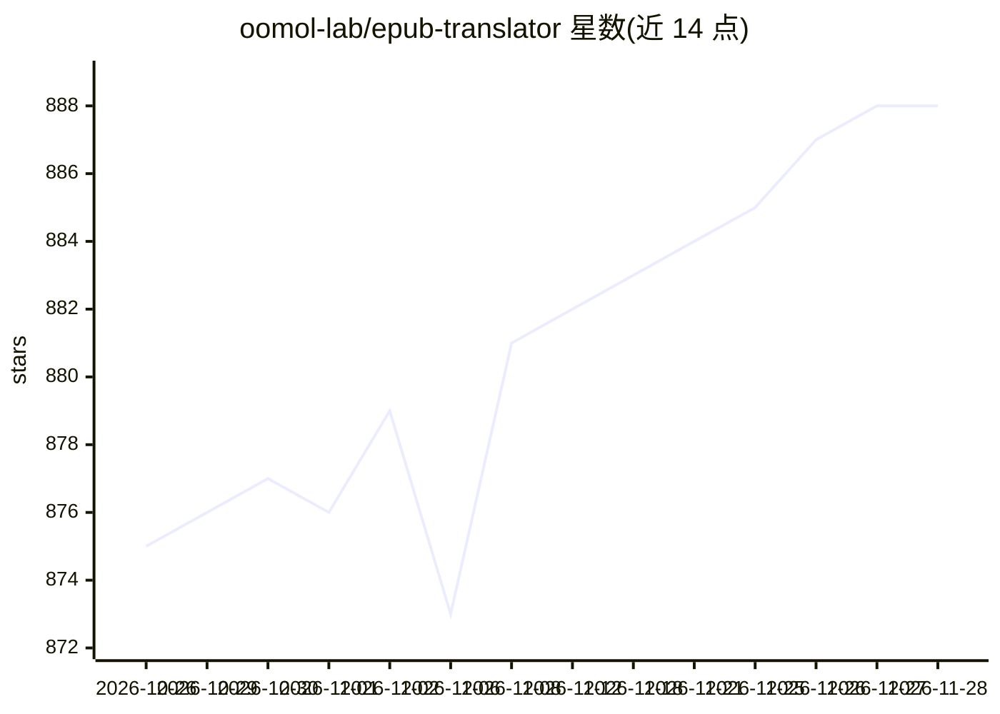

# oomol-lab/epub-translator

⭐ 888 · Python · MIT · 推送 2026-11-27 · [GitHub](https://github.com/oomol-lab/epub-translator) · [官网](https://pdfcraft.ai/epub-translator/?utm_source=epub_translator_github&utm_medium=referral&utm_campaign=pdfcraft_online&utm_content=repo_about) · 组织维护 · 中文 README

**面向外语阅读者的 EPUB 双语翻译工具：LLM 翻译并保留原文**

Python 库，用 LLM 翻译 EPUB 电子书并保留原文，输出双语或纯译文版本，保留章节、目录、图片与格式。支持三种提交模式（替换/内联追加/块级追加）、翻译与 XML 填充的双 LLM 架构、失败重试与缓存续译、并发翻译与 token 用量统计。需自备 LLM API key；也提供官方在线版、桌面/iOS 阅读器，以及 1-click 远程 MCP 与托管 REST API，可接入 Claude、Cursor、Codex 等工具。

## 筛选速览

| 维度 | 判定 | 备注 |
|---|---|---|
| AI 角色 | `ai-native` | 本体是模型或模型工具 |
| 许可风险 | `permissive` | MIT |
| 部署形态 | `library` | 以包/库形式分发 |
| 模型依赖 | locked-api |  |
| 硬件要求 | — | 无带数字的原话,不猜 |
| 安装摩擦 | `low` | 无编译、无系统依赖或容器化 |
| 成熟度 | — | 结构信号不足 |

## 能力要点

- 三种提交模式：替换原文、内联双语、块级双语（推荐）
- 双 LLM 架构：翻译与 XML 结构填充可分设不同参数
- 失败自动重试与缓存续译，并发处理与 token 用量监控
- 提供远程 MCP 与 REST API，可在 OOMOL Studio 可视化流程中运行

## 适用场景

- 把外文 EPUB 转成双语对照版辅助语言学习
- 生成保留章节与排版的纯译文电子书
- 通过 MCP/REST API 把整书翻译接入自己的应用
- 整书翻译中断后从缓存恢复继续翻译

## 场景标签

`AI 写作` · 领域:内容生成

## 证据(README 行号)

> L18: Want to read a book in a foreign language without losing the original context? EPUB Translator transforms any EPUB 
> L4:  pip install epub-translator
> L26:  Connect whole-book EPUB and PDF translation to Claude, Cursor, Codex, or your own apps via 1-click remote MCP and 

## 星数曲线

2026-10-26 875 → 2026-11-28 888（+13）

---
*卡片 v1 · prompt 1.4 · 生成 2026-11-28 · 置信度 high · 依据 README sha `56196d039dd9` · [字段定义](../../DATASET.md)*
