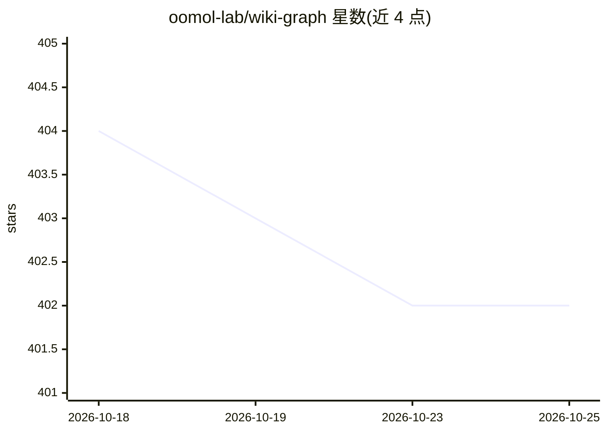

# oomol-lab/wiki-graph

⭐ 402 · TypeScript · Apache-2.0 · 推送 2026-10-19 · [GitHub](https://github.com/oomol-lab/wiki-graph) · [官网](https://pdfcraft.ai/download/sdpub) · 组织维护 · 中文 README

**长文本知识库 CLI：把书和文档提炼为可溯源知识图谱**

开源命令行工具（wg），面向 Karpathy LLM Wiki 与 Google OKF 方向：把外部工具转出的纯文本长文写入 .wikg 归档，经 WikiSpine 对照 Wikipedia/Wikidata 召回公共实体并用 LLM 消歧，抽取实体、三元组（subject--predicate-->object）与可回溯到章节原句的证据，按需构建 FTS 索引、Reading Graph 并生成摘要。知识库以单个 .wikg 文件组织，可复制分享；不覆盖私有实体（内部代号等）。提供 npm 全局安装与 Node.js SDK。

## 筛选速览

| 维度 | 判定 | 备注 |
|---|---|---|
| AI 角色 | `ai-ecosystem` | LLM/agent 周边工具 |
| 许可风险 | `permissive` | Apache-2.0 |
| 部署形态 | `library` | 以包/库形式分发 |
| 模型依赖 | — | README 未给出锁定关系 |
| 硬件要求 | — | 无带数字的原话,不猜 |
| 安装摩擦 | `low` | 无编译、无系统依赖或容器化 |
| 成熟度 | — | 结构信号不足 |

## 能力要点

- 纯文本长文 → Entity/Triple/Evidence 知识图谱，证据可回溯章节原句
- 公共实体对齐 Wikipedia/Wikidata QID，同一实体跨章节累积关系
- 基于认知分块的 Reading Graph 生成可溯源章节摘要
- wikg:// URI 体系与 FTS 全文检索、.wikg 可携带归档

## 适用场景

- 把书籍、课程、会议记录等长文沉淀为可检索可溯源的知识库
- 以单个 .wikg 文件组织、备份和分享个人知识库
- 为 Wiki/OKF 系统提供可继续消费的实体与关系素材层

## 场景标签

`知识图谱` · 领域:知识与检索

## 证据(README 行号)

> L8: Wiki Graph is an open-source CLI for managing long-text knowledge bases, built toward Andrej Karpathy's LLM Wiki ide
> L10: It writes plain text into `.wikg` archives and can generate searchable, source-traceable Knowledge Graphs on demand
> L109: Wiki Graph starts from a more determinate layer: public entities. Wikipedia / Wikidata acts like a shared public d

## 星数曲线

2026-10-18 404 → 2026-10-25 402（-2）

---
*卡片 v1 · prompt 1.4 · 生成 2026-10-22 · 置信度 high · 依据 README sha `88effeb4eb1e` · [字段定义](../../DATASET.md)*
