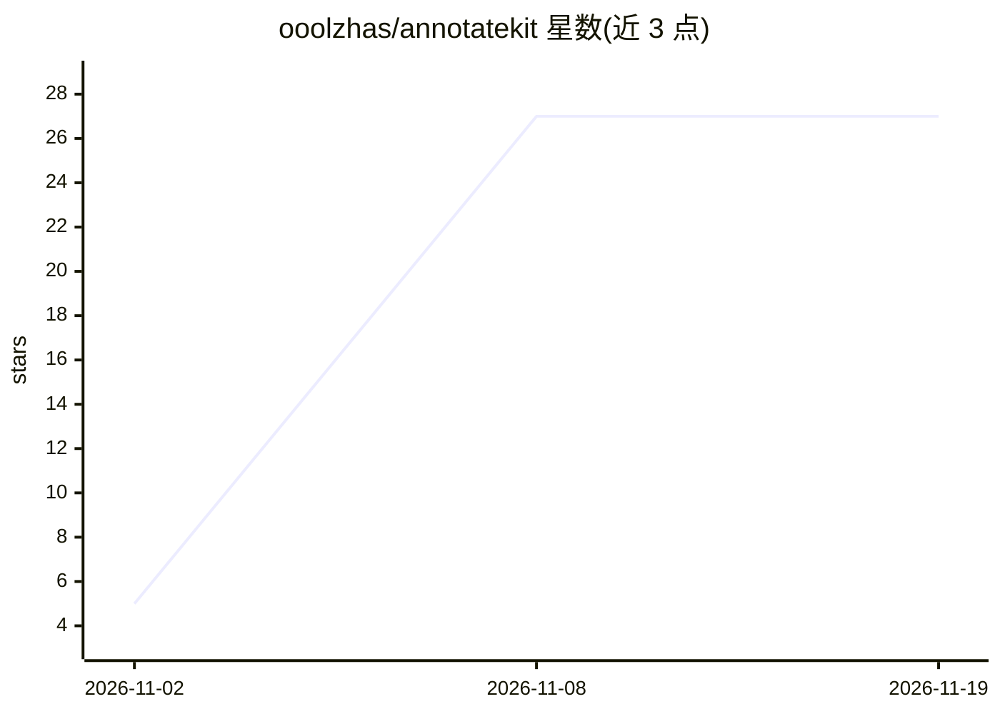

# ooolzhas/annotatekit

⭐ 27 · Swift · MIT · 推送 2026-11-04 · [GitHub](https://github.com/ooolzhas/annotatekit) · [官网](https://annotatekit.com) · 个人维护

**iOS 应用内的可视化标注反馈工具：把绘图与批注转成编码代理的提示词**

面向使用编码代理（Claude Code、Cursor、Codex 等 MCP 客户端）的 iOS 开发者的标注反馈库：在 SwiftUI/UIKit/React Native/Expo 应用中以 DEBUG 模式嵌入标注界面，用户点击、绘制、添加批注后，生成为包含截图、坐标、命中元素与设备元数据的会话包，作为提示词发送给编码代理，代理可通过 MCP 工具或 CLI 按批注逐条确认/解决。物理设备经 devicectl 拷贝会话包，无需网络权限；Release 构建不含任何相关代码。限制：仅 iOS 17+，Stage Manager 窗口与模拟器悬停高亮不支持。

## 筛选速览

| 维度 | 判定 | 备注 |
|---|---|---|
| AI 角色 | `ai-ecosystem` | LLM/agent 周边工具 |
| 许可风险 | `permissive` | MIT |
| 部署形态 | `library` | 以包/库形式分发 |
| 模型依赖 | locked-api |  |
| 硬件要求 | — | 无带数字的原话,不猜 |
| 安装摩擦 | `low` | 无编译、无系统依赖或容器化 |
| 成熟度 | — | 结构信号不足 |

## 能力要点

- 把绘图/批注转换为含坐标、命中元素、截图与设备元数据的代理提示词
- 支持 SwiftUI、UIKit、React Native、Expo，全部置于 #if DEBUG 之后
- 提供 MCP 服务器与 CLI，代理可逐条确认/解决/回问批注
- 物理设备经 devicectl 拷贝会话包，无需网络权限与 Info.plist 键

## 适用场景

- 在 iOS 应用上圈画问题并直接让编码代理改代码
- QA 或设计师用可视化批注替代文字描述 UI 缺陷
- 跟踪代理对每条批注的处理进度（received→working→applied）

## 场景标签

`提示工程` · 领域:Agent 开发

## 证据(README 行号)

> L12: prompts for your coding agent. Tap, draw, and send to Claude, Codex, Cursor, or any MCP client.
> L92: |**Cursor, Codex, VS Code, any MCP client**|Add `annotate mcp` (below) and ask the agent to *"keep calling annotati

## 星数曲线

2026-11-02 5 → 2026-11-19 27（+22）

---
*卡片 v1 · prompt 1.4 · 生成 2026-11-18 · 置信度 high · 依据 README sha `e4b3c03b5599` · [字段定义](../../DATASET.md)*
