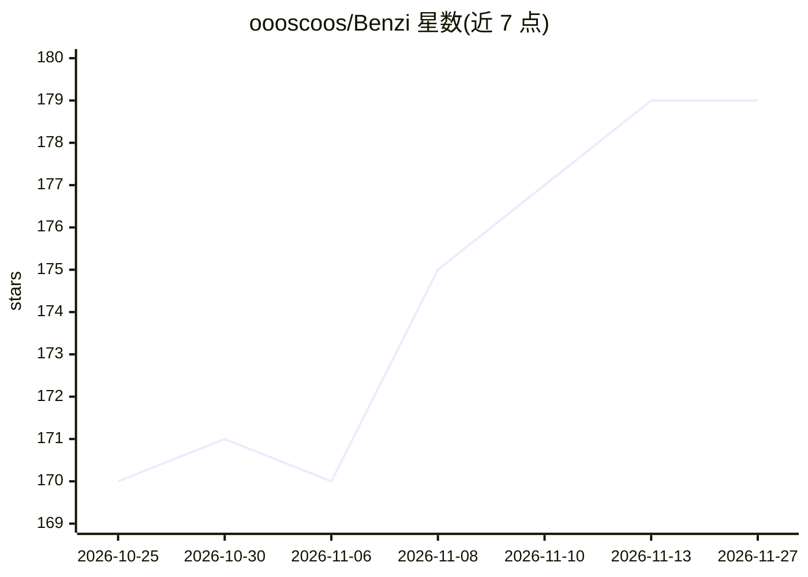

# oooscoos/Benzi

⭐ 179 · HTML · NOASSERTION · 推送 2026-11-09 · [GitHub](https://github.com/oooscoos/Benzi) · [官网](https://varianttech.net) · 个人维护

**为 AI 编码模型提供代码智能索引的基础设施**

Benzi 将代码库先编译为可查询的调用、数据流、控制流与类继承索引（基于 tree-sitter），再由 agent 基于该索引读取、解释、运行、编辑并验证代码。提供两种使用方式：自带 agent（VS Code 扩展或 headless CLI，含运行时追踪、静态分析门控编辑、模型升级）与将编译器作为 MCP server 接入既有 agent。支持 10 种语言，Python 支持最深且唯一带运行时追踪器，beta 期间免费使用，需登录并自备模型 API key。

## 筛选速览

| 维度 | 判定 | 备注 |
|---|---|---|
| AI 角色 | `ai-ecosystem` | LLM/agent 周边工具 |
| 许可风险 | `none` | NOASSERTION |
| 部署形态 | `library` | 以包/库形式分发 |
| 模型依赖 | — | README 未给出锁定关系 |
| 硬件要求 | — | 无带数字的原话,不猜 |
| 安装摩擦 | `low` | 无编译、无系统依赖或容器化 |
| 成熟度 | — | 结构信号不足 |

## 能力要点

- tree-sitter 编译出可查询索引：符号、调用边、引用、继承、数据流
- 静态分析无法确定的调用点标记六种状态而非猜测，靠运行时追踪确认
- 每次写入经语法与索引校验，破坏性编辑自动回滚
- 35+ 结构化工具（get_callers/backflow/trace_path 等）供 agent 查询

## 适用场景

- 为我的编码 agent 提供 MCP 形式的代码结构索引
- 在终端或 VS Code 中让 agent 定位调用方并追踪错误值来源
- 在编辑后运行复现脚本验证变更实际生效

## 场景标签

`编码 Agent` · 领域:编码与开发

## 证据(README 行号)

> L36: Most AI coding agents grep and glob raw source code into AI model's context window and hope the model finds what ma
> L124: 2. **The Benzi compiler as an MCP server** — the compiled index, served as tools to the agent you already use: Cla

## 星数曲线

2026-10-25 170 → 2026-11-27 179（+9）

---
*卡片 v1 · prompt 1.4 · 生成 2026-11-26 · 置信度 high · 依据 README sha `ef6abd4a591f` · [字段定义](../../DATASET.md)*
