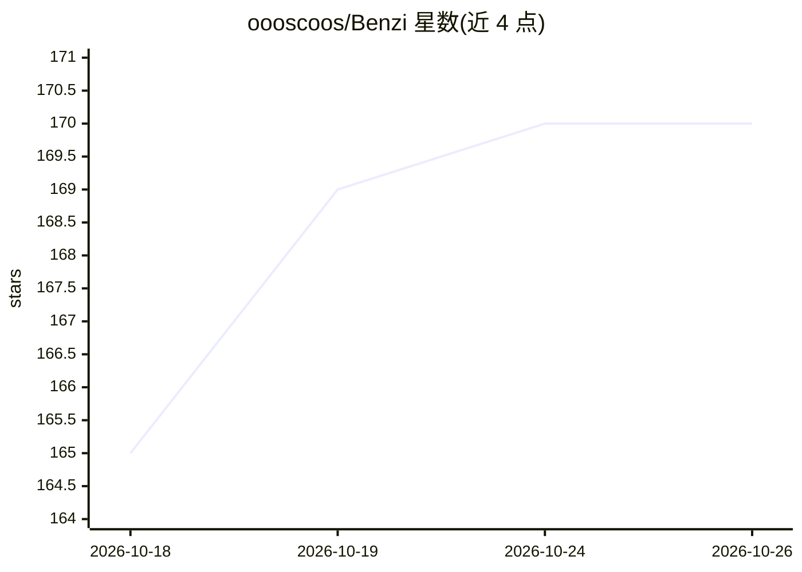

# oooscoos/Benzi

⭐ 170 · HTML · NOASSERTION · 推送 2026-10-23 · [GitHub](https://github.com/oooscoos/Benzi) · [官网](https://varianttech.net) · 个人维护

**编译器驱动的 AI 编程 agent：先把代码库编成可查询索引再改代码**

面向开发者的编程 agent：用 tree-sitter 将整个代码库解析为符号、调用边、引用、继承与数据流的索引（而非把源码 grep 进上下文），再通过约 35 个结构化工具读取、解释、编辑并运行验证代码。支持 Python/JS/Java/C++ 等 10 种语言，Python 之外语言深度不一；运行时追踪器目前部分损坏。以 VS Code 扩展、headless CLI（pip 安装）和 MCP server 三种形式提供，BYOK，beta 期间免费，需邮箱登录。

## 筛选速览

| 维度 | 判定 | 备注 |
|---|---|---|
| AI 角色 | `ai-ecosystem` | LLM/agent 周边工具 |
| 许可风险 | `none` | NOASSERTION |
| 部署形态 | `library` | 以包/库形式分发 |
| 模型依赖 | locked-api |  |
| 硬件要求 | — | 无带数字的原话,不猜 |
| 安装摩擦 | `low` | 无编译、无系统依赖或容器化 |
| 成熟度 | `idea` | |

## 能力要点

- tree-sitter 编译生成可查询的调用/数据流/继承索引
- 35+ 结构化工具（get_callers/backflow/trace_path 等）
- 静态门控编辑：破坏解析的写入自动回滚，含爆炸半径检查
- 同一索引可作为 MCP server 服务 Claude Code/Cursor 等已有 agent

## 适用场景

- 在大型代码库中定位坏值来源与受改动影响的调用方
- 以 headless CLI 在脚本和 CI 中自动修复测试
- 把编译索引作为 MCP 工具接入现有编程 agent

## 场景标签

`编码 Agent` · 领域:编码与开发

## 证据(README 行号)

> L32: Most AI coding agents grep and glob raw source code into AI model's context window and hope the model finds what ma
> L122: 2. **The Benzi compiler as an MCP server** — the compiled index, served as tools to the agent you already use: Cla
> L148: 1. **Compile.** Tree-sitter parses every file, resolves imports, builds class ancestry, traces every identifier to

## 星数曲线

2026-10-18 165 → 2026-10-26 170（+5）

---
*卡片 v1 · prompt 1.4 · 生成 2026-10-22 · 置信度 high · 依据 README sha `e00b4ac9ea84` · [字段定义](../../DATASET.md)*
