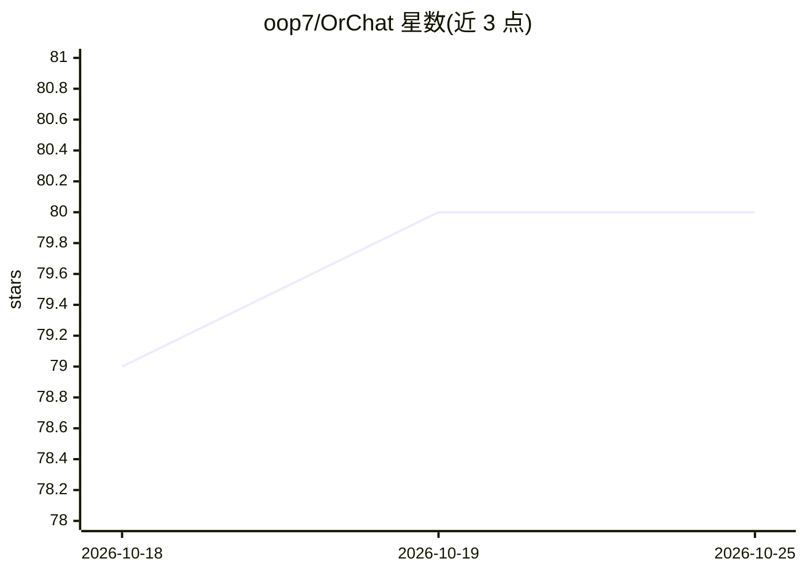

# oop7/OrChat

⭐ 80 · Python · MIT · 推送 2026-02-15 · [GitHub](https://github.com/oop7/OrChat) · 个人维护

**通过 OpenRouter 调用 AI 模型的终端聊天 CLI**

Python 编写的命令行聊天界面，经 OpenRouter API 接入其上的各类模型，提供流式响应、Markdown 渲染、多行输入、会话保存与 AI 生成的会话摘要、token/耗时/成本统计。支持用 `@` 附加本地文件与图片、URL 自动检测并抓取网页内容注入上下文、思维链模式展示。AI 可通过 `[EXECUTE: ...]` 请求执行 shell 命令，执行前显示风险分级面板并需用户确认。面向需要在终端中使用 AI 对话的个人用户，需 Python 3.9+ 与 OpenRouter API key。

## 筛选速览

| 维度 | 判定 | 备注 |
|---|---|---|
| AI 角色 | `ai-native` | 本体是模型或模型工具 |
| 许可风险 | `permissive` | MIT |
| 部署形态 | `library` | 以包/库形式分发 |
| 模型依赖 | locked-api |  |
| 硬件要求 | — | 无带数字的原话,不猜 |
| 安装摩擦 | `low` | 无编译、无系统依赖或容器化 |
| 成熟度 | — | 结构信号不足 |

## 能力要点

- 经 OpenRouter 接入任意可用模型，动态获取模型列表
- 带风险分级与人工确认的 agentic shell 命令执行
- `@` 文件附加（10 MB 上限、多模态图片）与 URL 自动抓取注入
- 会话保存/恢复 + AI 生成摘要与旧消息自动摘要以保持上下文

## 适用场景

- 在终端里直接与多种 AI 模型对话
- 让 AI 读取本地代码文件或网页内容并分析
- 保存并随时恢复带完整上下文的对话会话

## 场景标签

`聊天机器人` · 领域:对话与助手

## 证据(README 行号)

> L13: A powerful CLI for chatting with AI models through OpenRouter with streaming responses, token tracking, auto-update
> L19: - **Universal Model Access**: Connect to any AI model available on OpenRouter with dynamic model retrieval
> L118: - An OpenRouter API key (get one at OpenRouter.ai)

## 星数曲线

2026-10-18 79 → 2026-10-25 80（+1）

---
*卡片 v1 · prompt 1.4 · 生成 2026-10-24 · 置信度 high · 依据 README sha `02efcf1c7d8a` · [字段定义](../../DATASET.md)*
