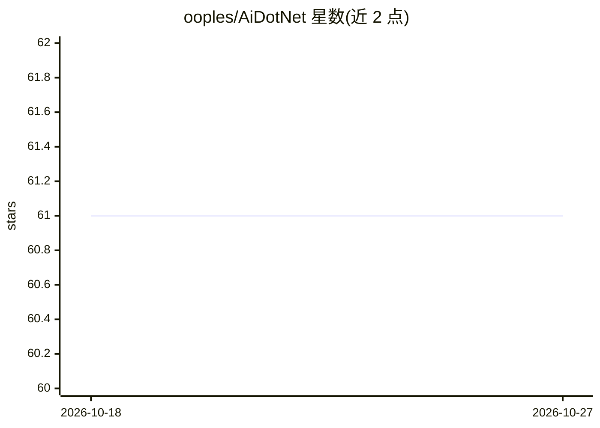

# ooples/AiDotNet

⭐ 61 · C# · NOASSERTION · 推送 2026-10-26 · [GitHub](https://github.com/ooples/AiDotNet) · [官网](https://ooples.github.io/AiDotNet/) · 个人维护

**.NET 平台的全功能 AI/ML 算法库：分类/回归/视觉/音频/RL 等**

面向 .NET 开发者的机器学习库，宣称覆盖 8,100+ 公共类、139 个模块：神经网络（160+ 架构）、分类/回归/聚类经典算法、计算机视觉（YOLO/DETR/SAM 等）、语音识别与 TTS（Whisper/VITS 等）、视频处理、50+ 强化学习 agent、扩散模型、LoRA 微调与 RAG 组件。API 采用 AiModelBuilder 链式配置模式，支持 AutoML 自动调参。要求 .NET 10/8 或 .NET Framework 4.7.1+，经 NuGet 以 dotnet add package 安装，README 提供按任务索引的快速入门与示例。

## 筛选速览

| 维度 | 判定 | 备注 |
|---|---|---|
| AI 角色 | `ai-native` | 本体是模型或模型工具 |
| 许可风险 | `none` | NOASSERTION |
| 部署形态 | `None` |  |
| 模型依赖 | — | README 未给出锁定关系 |
| 硬件要求 | — | 无带数字的原话,不猜 |
| 安装摩擦 | `medium` | 含编译或系统依赖之一 |
| 成熟度 | — | 结构信号不足 |

## 能力要点

- 160+ 神经网络架构与 155+ 经典 ML 算法
- 覆盖计算机视觉、音频（Whisper/TTS/音乐生成）、视频、强化学习
- AiModelBuilder 链式配置与 AutoML 自动调参
- 纯 .NET 实现，支持 CUDA/OpenCL/Vulkan GPU 加速

## 适用场景

- 在 .NET 项目中训练分类、回归、聚类模型
- 集成 YOLO 目标检测、Whisper 语音转录等能力
- 构建强化学习 agent（DQN/PPO/SAC 等）

## 场景标签

`语音合成` `语音识别` `目标检测` `强化学习` · 领域:内容生成

## 证据(README 行号)

> L71: dotnet add package AiDotNet
> L160: ### Classification (50 Algorithms)
> L372: ### Audio Processing (250+ Models)

## 星数曲线

2026-10-18 61 → 2026-10-27 61（+0）

---
*卡片 v1 · prompt 1.4 · 生成 2026-10-24 · 置信度 high · 依据 README sha `f595cbc068b4` · [字段定义](../../DATASET.md)*
